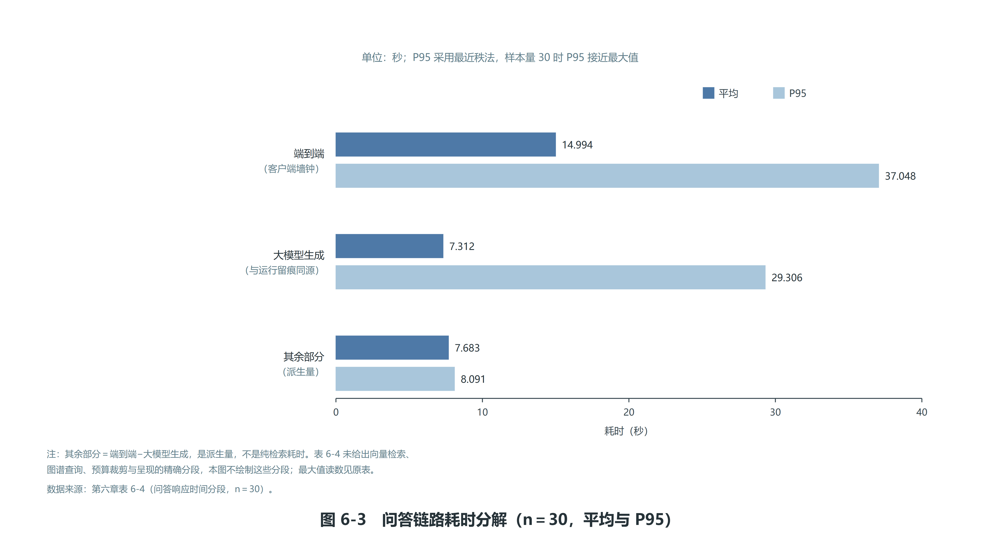
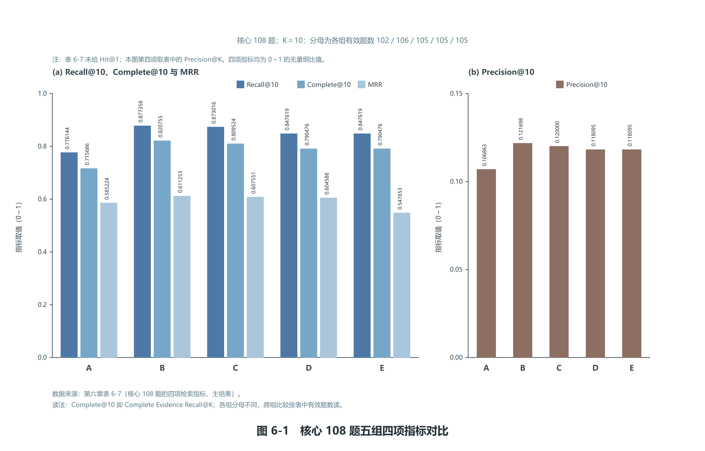
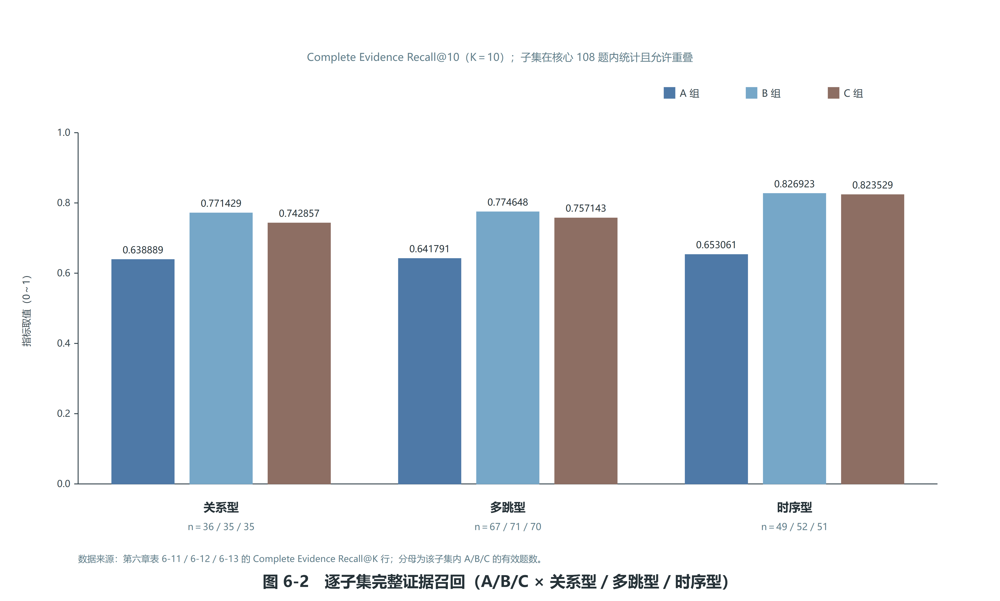

# 第6章 系统测试与实验分析

## 6.1 测试环境与实验配置

本系统的测试与实验在同一台个人计算机上完成，软件环境为 Python 3.12.10，依赖 pymysql、neo4j、faiss 与 transformers 等库；关系数据库为 MySQL 8.4.9（本机服务，端口 3306），图数据库为容器化的 Neo4j 5.26.31（端口 7474 与 7687），向量索引由本地的 FAISS 库加载。开发与实验期间，后端服务监听 8000 端口。健康探针覆盖四项：关系数据库、图数据库、向量索引与模型配置，四项全部为就绪状态时，健康接口返回的数据集口径为"向量 5018 条、维度 512"与"模型与提示词版本、K=10、N=20、预算=3600、g=2"。

需要说明的是，本系统的**实验类检查与读数复算不依赖任何服务在线**：检查的全部依据都落在已落盘的产物上，因此在后端服务与图数据库都未启动的环境下同样可以跑完并给出结论。这一点是刻意设计的——如果依据依赖服务，服务未启动就会被误判成内容缺陷。测试环境实测中，本机在部分轮次确实处于"8000 未监听、7687 未监听"的状态，全部测试与复算仍正常完成。

实验配置在实验开始前固定为八项，实验期间不得更改。其中 Embedding 模型为中文检索的常用基线模型，并固定了其版本标识；大语言模型固定为选型确定的那一个模型与版本；温度固定为 0；提示词版本固定为 v1.0；四项检索侧配置量固定为 **K＝10、N＝20、上下文预算＝3600、图谱侧保留份额 g＝2**。这四项定值由检索预实验按"在满足预算的前提下取 Complete Evidence Recall@K 饱和的最小 K"这一规则定出：预算不构成约束时 K 在网格内并未饱和，因此必须先定死预算再在预算下判饱和；在同一预算下把 K 从 10 提到 15 时该指标不再提升，且 K 取 15 时的文本块占用中位数已超过预算，故取 K＝10，N 取使该指标达到该档最大值的**最小** N。g 的取值为满足"四项指标均不劣于 g＝0"的 g 中的最大值且不低于下限 1，下限 1 的理由是**可检验性属设计约束**——保证图谱侧证据在每道题上至少有一个名额，g 取 0 会使方法组与基线组在最终证据集合上结构性相等。

表 6-1 给出本系统实验的固定配置。

**表 6-1　实验配置固定表（实验期间不变）**

| 配置项 | 取值 |
| --- | --- |
| Embedding 模型 | 中文检索基线模型，固定版本标识，512 维，L2 归一化后内积 |
| 大语言模型 | 选型确定的模型，提示词版本 v1.0 |
| 温度 | 0 |
| Top-K（K） | 10 |
| 向量候选数（N） | 20 |
| 上下文预算 | 3600 |
| 图谱侧保留份额（g） | 2 |
| 数据集版本与数据截止时间 | v2.1；数据截至 2026-09-25 |

数据集与图谱的实验基线为：数据集 v2.1 含 709 篇文档、5018 个文本块；图谱交付口径含 3607 个节点与 3614 条边。实验题集口径为 120 题，其中核心题 108 题、压力子集 12 题；压力子集为"关系型＋两跳＋有时间约束"的组合，**必须单独报告，不得并入核心题的总体平均**。

题集本身经过一次逐题机检，读数如后：题集为每题附带的引文锚点（即 `anchor`）在对应证据块原文中去空白后**逐字命中 249 条**，且 120 题逐题至少命中 1 条；带时间约束的题 66 道，其参照证据文档全部落在可过滤文档集合（66 篇）之内；与 30 题预实验集的参照证据集合完全相同的题为 0 道。这三项读数说明题集本身可用，**但它们只是题集的构造性机检，不构成任何一组的检索或问答结果**。

需要在本节明确登记两条读数边界，这是本章最容易写错的地方。第一层是**预实验层**：对照与消融运行的先行版本建立在 30 题预实验集之上，每一组各 30 条运行记录；该层的任何读数都**不是正式实验结论**，引用时必须写明“30 题预实验集”。第二层是**正式全量层**：120 题 × 6 组共完成约 720 次大模型调用，正式读数落点为 `交付物/06-实验与评测/对照产出_正式/`（`A_vs_C_对照报告.md` 与 `A_vs_C_对照.json`），本章 6.7 至 6.10 四节即按该层读数展开。两层的分工是：**预实验层用于验证管线与定值，正式全量层用于给出结论**；凡涉及正式全量的指标读数一律取自正式层落点，预实验层读数只在需要作方向对照时出现、并逐处标明“30 题预实验集”。

正式全量层的口径与规模如下：有效题数为 **A 113／B 118／C 117／D 117／E 117／B1 120**（120 题口径），核心 108 题口径下为 **A 102／B 106／C 105／D 105／E 105**。6.7 至 6.10 四节依次为：6.7 检索实验（核心 108 题四项指标 ＋ 压力子集 12 题 ＋ 全部 120 题总览 ＋ 逐子集读数 ＋ 失败题与分母口径）、6.8 问答对比实验（正式集问答质量评分、五组三维度均值与 12.8 判定表）、6.9 消融实验（C→D 与 D→E 的逐题比对、时间过滤三层口径）与 6.10 失败案例分析（答案侧门禁未通过的题次、六类归因的代理判据与计数）。

> **口径说明。** 本节曾按“正式全量实验尚未运行”写成两条边界（“6.7 至 6.10 四节一律留空”），该状态已到期；正式全量实验 120 题 × 6 组已完成、四节已按正式读数回填。本节按终稿口径改写为“预实验层／正式全量层”的分工，**未改动任何读数**；相关版本演进可查本章修订记录与项目执行总控文档的修订史。

此外，本文如实登记一项与实验口径无关的边界例外：系统页面上为演示需要实现的"实时数据区"是**演示增强组件**，它不进任何实验组、不进证据链、不写入任何一张表，也不计入任何指标；本课题**没有**接入实时行情，该组件也不作为任何实验口径或数据来源依据。

## 6.2 评价指标定义与评分标准

本章使用的指标分三组：抽取指标、检索指标与问答指标，另有系统指标单独在 6.6 节报告。

抽取指标用于回答"财经事件能否被稳定地结构化表示"这一问题，其对照物是**金标准（三模型综合）**，因此本节及 6.3 节的主口径抽取读数一律限定为"**金标准（三模型综合）口径下的抽取表现**"。所谓金标准（三模型综合），是指由三个不同厂商的模型（`deepseek-flash`、`kimi-k2.7-code`、`glm-5.3-flash`）按同一套固定提示词在同一批 260 条文本块上**各自独立标注**，再逐条取事实的跨模型共识：被不少于两家认领者判入金标准，三家均认领者取一致值，家内部分歧时取可对齐者的字段值，无法对齐的属性按"不猜测"纪律留空并记为未决。为便于与既有结论逐项对照，本文同时保留一套**对照口径**——由单一模型（`deepseek-flash`）在温度 0 下自动标注、再经离线规则扫描与两轮定向修复形成的单模型参照集；两套读数的判据与聚合方式逐字一致，差异只来自对照物，故**并存报告、不互相替换**。指标为实体、事件、关系与时间四类任务的精确率、召回率与 F1，判据为主判据（键＝类型＋规范化名字，逐字相等才算命中）与宽松配对口径（在主判据之外，再按"类型字段一致且两侧证据引文去空白后互相包含"贪心配对）两种，**两个口径都必须报告，不得只报宽松的那一个**。四类任务的聚合口径为 micro，即把各文本块的命中、误报与漏报直接相加后再计算。

这里必须把口径的性质说清楚，以免读者误读。第一，**金标准的每一个条目都是模型判断的产物**，本文没有引入人工逐条标注这一步，因此该口径下的精确率、召回率与 F1 **不得读作"准确率"**，也不得写成任何以人工标注为对照物的表述；"金标准"在此指的是**三模型共识口径**，其价值在于消除了单一模型自证的循环，但仍属模型口径而非人工口径。第二，对照口径的单模型参照集与抽取器同端点、同模型家族（其标注模型更与抽取器同模型），两者之间的一致**不构成独立验证**，这正是本文另建三模型共识金标准的原因；两套读数并列即可看出结论对对照物选择的敏感程度。第三，已登记的偏倚方向是：单模型参照集比多模型共识更紧、以漏标为主，因此在单模型口径下抽取的精确率与召回率**都被低估**；换成三模型共识后，事件召回率由 0.0712 升至 0.2449，正是这一偏倚被纠正的直接证据（见 6.3 节表 6-3 的对照说明）。第四，条目级的"完全一致率"不能当准确率读——第三方模型盲标复核显示该指标只有 12.5% 到 30.0%，差异主要来自收录门槛与粒度而非类型判断分歧；可跨模型复现的是分层指标（实体类型一致率与事件类型分布差异），因此本文将读数拆到分类型。第五，三模型之间在**事件**类上的共识最弱：260 条评测块上三模型共识的事件条目仅 49 条，而共识实体 672 条、关系 564 条、时间 111 条；这说明模型对"什么算一个事件"的粒度与措辞判断分歧明显，本文如实登记这一模型间一致性上限，不以任何方式回避。


检索指标四项，主口径统一为文本块级，其定义如下。Recall@K 为前 K 条中命中的证据文本块数除以该问题的证据文本块总数，按问题取平均。Precision@K 为前 K 条中属于证据的文本块数除以 K（**分母恒为 K**，不足 K 条时空缺位置记未命中），按问题取平均。MRR 为第一个证据文本块所在排名的倒数，按问题取平均，前 K 内无证据则该问题记 0。Complete Evidence Recall@K 为该问题的证据文本块全部出现在前 K 条中记 1、否则记 0，按问题取平均。"召回了多少"由 Recall@K 承担，"是否全部召回"由 Complete Evidence Recall@K 承担，因此不另设同义指标。文档级口径只在需要诊断时作为辅助使用，且必须单独标注，不得与文本块级混算。四项指标都在 4.6 节所述的"最终证据集合五步契约"得到的集合上计算。

问答指标三项，取值均为 0、1、2。Answer Accuracy 的取值为：0 表示错误，1 表示部分正确，2 表示完全正确。Completeness 的取值为：0 表示关键信息大量遗漏，1 表示基本覆盖，2 表示信息完整。Faithfulness 的取值为：0 表示存在明显无依据事实，1 表示少量不严谨，2 表示完全基于证据。

关于问答指标的评分主体，本节需要明确登记一处口径：本课题的问答三项指标**采用跨厂商模型评审（模型评分）**的方式给出——由三个不同厂商的大模型（`deepseek-flash`、`kimi-k2.7-code`、`glm-5.3-flash`）按上述原量表逐字**各自独立评分**，逐条答案的三家分数取**均值为主读数**、取**多数（或中位）为辅读数**；三家逐维一致、两家一致加一家分歧、三家互不相同的分布均如实登记，一致率只说明"模型之间判断是否相同"。因此**凡引用问答准确率，一律限定为"金标准（三模型综合）口径下的准确率"**。这里有三条边界必须同时写明：其一，**三模型评分仍全部由模型给出，本文不存在人工评分这一步**，所谓"金标准"在此指的是三模型共识口径，其作用是消除单一评分方的模型偏好，**不得**把这一表述读作"经过人工核验的准确率"；其二，三家之间的逐维一致率**不得**写成评分者一致性或评分信度，它只度量模型间判断的相同程度；其三，评分标准（即上面的 0、1、2 定义）在实验开始前固定，不得在看到结果之后调整。需要如实登记的是，评分方之一对温度为 0 的请求存在拒收情形，实测回退到温度为 1 的取值，因此该评分存在一处温度不可控的已知限制；三家逐条覆盖 582 条有效答案（详见 6.8.1），其中逐维三家全同 1614 项、三家内两家一致 121 项、三家互不相同 1 项。

系统指标沿用第3章非功能需求的口径：响应时间一项要求在统一的测试环境下记录平均回答耗时与 P95 耗时并分段；并发能力一项包含两条并列口径——10 个并发用户下接口成功率不低于 95%，以及连续 100 次请求成功率不低于 95%，**两条口径都必须报告，不得只报较高的那一个**。本节另登记三条与读数一起解释的规则：P95 采用最近秩法，样本量较小时 P95 接近最大值，因此**必须连样本量一起读**；背靠背连续请求的失败若全部来自服务端限流，则该结果反映的是服务端的主动保护行为，**不得写成"系统可用性为某个百分比"**；分段耗时只能报告实际取得的分段，派生量必须标注为派生量。

## 6.3 抽取实验

本节报告 RQ1 的抽取评测结果。主口径读数即 6.2 节登记的"**金标准（三模型综合）口径**"（口径定义与性质见 6.2 节）；单模型参照集口径的读数作为**对照口径并列报告**（见本节末表 6-3），两套读数并存、不互相替换。

**评测的规模与对照物。**评测条目为开发集 60 条加测试集 200 条，合计 **260 条**，单位是文本块，两段文本块不重叠。金标准由三个不同厂商的模型（`deepseek-flash`、`kimi-k2.7-code`、`glm-5.3-flash`）按同一套固定提示词独立标注后取**逐条事实被不少于两家认领**的共识构成，共识门限为三分之二；三家均认领者取三家一致，三家内部分歧时按"不少于两家"判入、字段值取可对齐者，未能对齐的属性按本文的"不猜测"纪律留空并记为未决。系统侧取值来自整篇抽取产物（一行一篇文档，每条事实带来源文本块编号），逐块视图即按该字段筛选；评测不使用消歧与去重之后的导出物，因为那会把消歧与去重的损益混进抽取指标，口径不清。

**匹配判据。**名称规范化与既有脚本逐字一致（去空白后再剥最外层包裹字符，不做大小写折叠、宽度折叠、简繁折叠与模糊匹配），本脚本直接导入既有模块取值，不复刻、不另立一套。四类任务的键分别为：实体为"实体类型＋规范化名字"；事件为"事件类型＋规范化事件名"；关系为"关系名＋两端身份"（端点先解析到实体或事件身份，解析不到再退回标签）；时间为"时间类型＋取值"。按块计数，命中为两侧键集合的交，误报为系统侧减去金标准侧，漏报为金标准侧减去系统侧。证据关系不计入对拍——它是结构性关系，系统侧由写入脚本按文档编号生成，标注协议也不写它，两侧一致地排除，因此关系任务的分母是其余八条关系。

**四类指标（主判据，micro）。**金标准（三模型综合）口径下的实测结果如表 6-2 所示。

**表 6-2　金标准（三模型综合）口径下的抽取表现（主判据，micro）**

| 任务 | 分段 | 命中 | 误报 | 漏报 | 精确率 | 召回率 | F1 | 宽松配对 F1（上界） |
| --- | --- | --- | --- | --- | --- | --- | --- | --- |
| 实体 | 开发集 | 55 | 14 | 111 | 0.7971 | 0.3313 | 0.4681 | 0.5106 |
| 实体 | 测试集 | 199 | 58 | 307 | 0.7743 | 0.3933 | 0.5216 | 0.5478 |
| 实体 | 合计 | 254 | 72 | 418 | 0.7791 | 0.3780 | **0.5090** | **0.5391** |
| 事件 | 开发集 | 2 | 24 | 7 | 0.0769 | 0.2222 | 0.1143 | 0.1714 |
| 事件 | 测试集 | 10 | 88 | 30 | 0.1020 | 0.2500 | 0.1449 | 0.2609 |
| 事件 | 合计 | 12 | 112 | 37 | 0.0968 | 0.2449 | **0.1387** | **0.2428** |
| 关系 | 开发集 | 5 | 56 | 146 | 0.0820 | 0.0331 | 0.0472 | 0.4245 |
| 关系 | 测试集 | 28 | 195 | 380 | 0.1256 | 0.0686 | 0.0887 | 0.4277 |
| 关系 | 合计 | 33 | 251 | 526 | 0.1162 | 0.0590 | **0.0783** | **0.4269** |
| 时间 | 开发集 | 8 | 2 | 27 | 0.8000 | 0.2286 | 0.3556 | 0.3556 |
| 时间 | 测试集 | 23 | 14 | 53 | 0.6216 | 0.3026 | 0.4071 | 0.4071 |
| 时间 | 合计 | 31 | 16 | 80 | 0.6596 | 0.2793 | **0.3924** | **0.3924** |

由上表可见，在同一把尺子下，实体与时间的表现明显好于事件与关系：实体的精确率较高而召回率偏低，时间的精确率较高而召回率同样偏低；事件与关系在两个判据之间的落差最大：事件 F1 由主判据的 0.1387 抬升到宽松配对口径的 0.2428，关系由 0.0783 抬升到 0.4269。

**对照口径读数（单模型参照集）。**为便于与本文既有结论逐项对照，下表给出同一套判据、同一套聚合方式在单模型参照集（`deepseek-flash` 自动标注并经离线规则定向修复）上的读数。两套读数的差异只来自对照物，判据与聚合方式逐字一致。

**表 6-3　单模型参照集口径下的抽取表现（对照口径，主判据，micro）**

| 任务 | 合计命中 | 合计误报 | 合计漏报 | 精确率 | 召回率 | F1 | 宽松配对 F1 |
| --- | --- | --- | --- | --- | --- | --- | --- |
| 实体 | 257 | 69 | 376 | 0.7883 | 0.4060 | 0.5360 | 0.5631 |
| 事件 | 19 | 105 | 248 | 0.1532 | 0.0712 | 0.0972 | 0.4348 |
| 关系 | 52 | 232 | 529 | 0.1831 | 0.0895 | 0.1202 | 0.4439 |
| 时间 | 30 | 17 | 75 | 0.6383 | 0.2857 | 0.3947 | 0.3947 |

两套读数的对照给出三条可解释的差异，且方向都与已登记的偏倚一致。其一，**事件的召回率由 0.0712 升至 0.2449**，因为单模型标注偏保守、以漏标为主，凡系统抽到而单一标注模型未标的条目一律计入漏报；换成三家共识后这类漏标被补回，系统事件的真实召回浮现，这印证了本文登记的"旧口径低估召回"偏倚方向。其二，**实体与关系的 F1 小幅下降**（0.5360→0.5090、0.1202→0.0783），因为三模型共识门限更严（须不少于两家认领），系统侧那些仅一家认领的实体与关系不再被计为命中，精确率与召回率都更保守。其三，**事件与关系在两个判据之间的落差显著收窄**（事件 0.4348→0.2428、关系 0.4439→0.4269），说明在共识口径下系统的事件与关系条目与金标准的可对齐性优于单模型口径所显示的水平。**时间类读数基本持平**（0.3947→0.3924），因为时间判据是取值相等、不依赖措辞，两种对照物下的结论一致。

**这个落差本身说明："事件名与关系端点名是自由文本"这一条对读数的影响远大于抽取能力本身。**主判据要求两侧的字符串逐字相等，而两个不同的模型对同一件事几乎不会写出完全相同的名称，因此事件与关系在主判据下天然偏低，这是判据的性质，不是"抽取几乎全错"。因此**引用任何单一口径的数字时都必须说明是哪一个口径**，且不得只报宽松的那一个。

**分类型读数比总读数更可靠。**按事件类型分，合计支持数最高的是"股权"（85 条，F1 0.0360）、"重大合同"（41 条，F1 0.0656）与"监管"（13 条，F1 0.0833），表现相对最好的是"政策"（20 条，F1 0.2667）与"投资并购"（8 条，F1 0.1538）。按实体类型分，人物（90 条，F1 0.6567）与公司（347 条，F1 0.5441）明显好于行业（17 条，F1 0.0833）。按关系分，"高管任职"（59 条，F1 0.5495）表现最突出，而"参与关系"（451 条，F1 0.0665）与"关联关系"（48 条，F1 0.0323）很低。

**异模型反向对照。**把参照集换成另一个厂商模型未经定向修复的标注版本重算，四类 F1 分别为实体 0.4985、事件 0.0836、关系 0.0893、时间 0.3759，与主口径同量级。这说明**低值不是同源自证造成的假象**。两份读数并列报告，不用其中一份去证明另一份对或错。

**已知限制（必须与上述读数一起引用）。**本评测的已知限制共 9 条，逐条如下。

第一，**金标准的每一个条目仍都是模型判断的产物，未做人工逐条复核**。三模型共识消除了"单一模型与抽取器同源"的循环论证，但三家都是模型、都不是人，共识只把偏差从"单家偏好"降为"三家多数偏好"，并未引入人工口径；因此本文所有抽取读数都不得读作"准确率"。三家之间在事件类上的共识尤其弱（共识事件仅 49 条，而共识实体 672 条、关系 564 条、时间 111 条），说明模型对"什么算一个事件"的粒度与措辞判断分歧明显，这一模型间一致性上限如实登记于此。

第二，偏倚方向已登记：参照集比多模型共识更紧、以漏标为主，因此抽取的精确率与召回率**都被低估**。这不是本次评测新引入的判断，而是既有登记口径的复述。

第三，**条目级完全一致率不能当准确率读**。三条第三方模型盲标线对同一批 40 条抽检样本的条目级完全一致率只有 12.5% 到 30.0%，差异主要来自收录门槛与粒度，不是类型判断分歧；可复现的是分层指标。本评测因此把读数拆到分类型。

第四，**归属位差与"块对文档"的结构差**。系统侧的块归属是"引文落在哪一块"的函数，参照集是"标注对象就是这一块"，两者在跨块边界处会出现归属位差。本次有 73 个文本块（开发集 17、测试集 56）在系统侧没有任何事实被归属到它，其中 59 块在参照集里是有事实的。更根本的一层是：参照集逐块过模型（每条目只标注该块），系统逐文档过模型（把整篇正文一次性给模型，并设条数上限），而被评测块只占其文档平均 9.6 个文本块中的 1 个。

第五，**判据松紧的影响**。引文参与匹配后命中只会减少；角色参与后关系命中再减少；兼容判据把事件端点压成字面量、粒度更粗。主判据与宽松配对之间的落差本身就说明引用任何单一口径的数字时都必须说明是哪一个口径。

第六，**没有对拍、也无法对拍的字段**。参照集的实体类型专属属性（股票代码、简称、别名、交易所、机构类型、政策编号、发文机关、发布日期、人物编号、职务、行业代码、层级等）在系统侧的抽取结构里根本不抽，缺失属本体层差异、不是抽取错误；参照集的参与方数组与系统侧把参与方编码在参与关系里的形状不同；参照集的本体边界登记与备注在系统侧无对应槽位；描述与置信度两侧都有但因表述自由、无客观判据，属于**有意不测**而不是遗漏；有效期在两侧结构不对称——参照集这两类时间共 20 条但不挂在关系上，系统侧只能从关系上反推，因此分类型表中这两行的召回为 0 **主要是口径不对称造成的，不能读成"系统完全不会抽时序"**。

第七，**本体覆盖面的两侧不对称**。系统侧抽出了八类关系，参照集只出现六类；系统侧多出的类型全部落成误报，这是"参照集没标"而不是"系统抽错"，引用分类型表时必须一起读。

第八，**类型必须一致才算命中**。键里含类型，故"名字抽对、类型判错"会同时记一个误报与一个漏报。若改成只比名字不看类型，实体读数会更高；本次坚持含类型，因为本体类型判定本身就是 RQ1 的一部分。

第九，**反向对照只作对照**。异模型参照集同源风险更低但没有经过规则定向修复、硬命中更多，两份读数并列，不用来互相证明谁对。

**交付文件的状态。**抽取评测集的交付文件 `dev.jsonl`／`test.jsonl` 是**纯抽样产物**，**不带任何标注字段**（原「260 条交付槽位」连同 `annotation` 字段已按作者决定整体撤销）；**本次评测没有做任何代填**，也没有把任何模型产物写进交付文件。冻结契约禁止的是"把模型产物写进交付文件"，本次的做法是另立一份公开、可复算的参照集并与系统抽取结果对照，**没有写进交付文件**。这一点是 RQ1 可信度的底线：若用脚本、规则或模型产物去填交付文件，交付文件就不再是纯抽样产物，"参照独立于系统"这一前提即被摧毁。**（2026-10-09 撤销登记 · 作者决定）**：**「逐条参照标注抽取评测集 260 条」这一交付要求已按作者决定正式撤销（withdrawn）**——**交付文件仍为纯抽样、未代填**，但它**不再是待办、缺口或未完成项**，本节亦**不再把它列为"尚未完成的一步"**（登记见《02-项目执行总控文档》修订记录 v3.14 与 第12.3节 第 ⑥ 段、《16-事件抽取与知识图谱（第六阶段）》第7.6节 第 7 条）。**「交付文件不得由脚本、规则或模型代填」这条保护性禁令继续有效、且此后永久有效**；本节的全部读数与结论**不因此变化**。

**本节读数的可复算性。**评测完全由确定性脚本完成，**零模型调用、零联网**，同一输入两次运行逐字节一致；三个产出文件均为固定顺序、换行符统一、编码无字节序标记。因此本节读数可以由任何持有数据集与脚本的人独立复算。

## 6.4 功能测试

功能测试覆盖六个功能模块与七项非功能需求中可功能化验证的部分，由三层材料支撑：单元测试、集成冒烟与逐阶段检查脚本。

**单元测试。**本项目的单元测试针对系统行为而非"文档与产物一致性"，Python 侧覆盖八组内容：Top-K 五步契约与分层保留顺序；四项检索指标的边界；答案三段确定性拼装、零跳标注、引用越界与词元账；后端错误码映射；数据准备的正文清洗、标题规范化、判重口径与文本切分；抽取与图谱的空白归一、逐字引用定位、置信度与日期归一、简繁折叠与图谱落盘字面量；以及后端业务接口的成功路径、统一错误信封与边界输入。测试共 **582 例**，全部通过，失败 0、跳过 0（2026-10-20 实测）。测试完全离线：会话级夹具装有网络审计钩子，任何网络连接、域名解析或 HTTP 请求当场抛错，守卫自身另有负向标定用例。测试对产品目录一个字节都不写（禁写字节码缓存），运行后产品目录下被写过的缓存文件数为 0；测试自身的运行约定也不在工作区落缓存目录。此外，测试对五个同名配置文件做了隔离设计：按文件路径加载产品模块并给唯一模块名，加载期显式管住模块解析目标，加载后原样恢复；一条负向标定用例专门验证"隔离一失效，检索管线会拒绝加载"。实测结果为：一次性跑全量 582 例通过，退出码为 0。此前 2026-10-17 的基线为 289 例（模块隔离／五步契约／检索指标／答案拼装／后端错误码五组共 122 例、数据准备与抽取与图谱两组各 46 例、后端接口一组 75 例），此后随检索融合、契约快照、参数契约与可观测性等用例补充，当前基线更新为 582 例；后端接口用例覆盖新增的关键词检索、图谱实体详情与实体级证据等路径的成功路径、统一错误信封与边界输入。

**前端单元测试。**前端（Vue 3 ＋ Vite）另有独立的一套单元测试，对 API 通信层、知识图谱渲染器的数据构造与滚动入场判据共 **84 例**，全部通过（2026-10-20 实测；此前 67 例为历史基线）。其中 API 层用例覆盖可展示错误类型的三条失败分支（网络层失败、非 JSON 响应、后端错误信封）、成功信封取数与查询参数拼装；图谱层用例覆盖连通分量识别、分量中心选取、跳数计算与路径枚举；入场层用例覆盖视口判据与隐藏视图跳过。前端测试同样完全离线：网络请求一律以进程内替身替代，不发真实请求。

**集成冒烟。**集成冒烟矩阵共 **44 行**，其中正常路径 28 条、异常场景 16 条，一行一个用例，字段含方法、路径、用例说明、期望错误码、实测错误码、HTTP 状态、耗时与证据指针。实测 **44 行的期望错误码与实测错误码逐行一致**。正常路径按模块分布为：后台文档增删改查 5 条、后台运维 7 条、受控实验入口 1 条、图谱 5 条、问答 4 条、配置 1 条、证据与文档块 3 条、历史 2 条。其中后台运维一条的代表读数为一致性检查耗时 1.147 秒、文本块数与向量条数均为 5018 且一致性判定为真（该行留痕采集于图谱口径切换之前，其中的图谱计数已由 2802／2736 更新为 3607／3614；文本块数与向量条数同为 5018 这两项不随该口径变化）；图谱一条的代表读数为按关键词检索引擎实体返回 21 条、一跳邻居边 21 条、路径 11 条、按事件类型检索返回 53 条；问答一条的代表读数为三次正常提问分别耗时 9.431 秒、9.168 秒与 14.036 秒；历史一条的代表读数为某会话下历史列表总数 30。

**异常场景。**异常场景共 **10 类 16 行**，覆盖空输入、超长输入、缺必填字段、参数格式错、不存在的资源、空结果、被历史引用、越权、图谱服务不可用、模型侧超时与失败。16 行的"异常后服务存活"判定**全部为正常**，即逐类异常后服务均未中断、未出现未捕获异常导致的页面失效。异常场景数 10 类，满足"不少于 6 类"的口径要求。其中三类读数需要说明：其一，空结果被定义为正常状态而非错误，以成功状态返回空列表，这类场景返回的是成功码而不是错误码；其二，删除或修改被历史回答引用的文档时返回"被历史引用"错误码，响应中同时说明该文档未被执行物理删除、历史继续可查；其三，有一条场景在最初采集时出现错误码错配——真实原因是模型端点拒绝该模型标识，而响应提示写的是"图谱服务不可用"，该错配后来被定位并修复，同一场景现返回模型侧错误码。

**功能测试中的三条实测读数。**第一，可维护性方面，模型接口地址、数据库连接与检索参数集中在配置文件中管理，更换模型不需要修改前端代码；前端无需改动，新环境按部署说明即可完成一次完整部署。第二，数据一致性方面，一致性检查接口可核对抽取结果与图谱节点数量、文本块数与向量条数；实测文本块数 5018、向量条数 5018、一致性判定为真；图谱口径切换后一致性检查的实况读数由 2802／2736 更新为 **3607／3614**，待消歧条数由 1070 降为 1040。第三，服务健康终态为四项探针全部就绪，健康接口始终返回成功状态，供一键启动脚本与检查脚本判断服务是否就绪。

**阶段检查脚本的运行读数。**本项目的每个阶段都配有一支检查脚本，按该阶段事先写定的验收标准逐行判定，每一行都由脚本现场重算，不读文档中登记的结论。第 9 阶段（前后端系统集成）的检查共 **58 行**（分为九组，各组行数为 6、8、10、6、6、6、6、5、5），实测 **58 行全部通过、退出码 0**，环境与链上失败 0 行；其自检档含 12 个定向篡改反例，逐例"期望失败集等于实测失败集"，退出码 0。第 10 阶段（系统测试与对比实验）的检查共 **46 行**（分为七组），实测 **46 行全部通过、退出码 0**；其静态档执行 42 行、未执行 4 行（记未执行）、退出码 2；自检档含 13 个定向篡改反例，逐例一致、退出码 0。检查脚本的行结构在运行时从该阶段的验收标准解析：解析出的行号、标题与判据必须与脚本登记的内容逐行一一对应，两者不一致即按"未执行"退出，以防止"标准改了、脚本没跟上"。

## 6.5 接口测试

接口测试针对后端注册的全部业务接口与错误处理逻辑展开，测试材料为集成冒烟矩阵的 44 行记录与接口侧的异常场景记录。

**接口覆盖。**按表 4-13 的口径，表 4-13 的 28 行接口清单减去 3 个第一版不启用的条件性登录接口，得到 **25 个核心业务接口**（23 条路径、25 个操作）。按模块分布为：问答 2 个、配置 1 个、证据 2 个、文档块 1 个、历史 2 个、图谱 5 个、后台 12 个（含文档增删改查、重新处理、一致性检查、抽取任务与事件查询、待消歧列表与消歧确认、受控实验入口）。除这 25 个以外，后端另注册关键词检索 1 个操作、图谱实体详情与实体级证据 2 个操作，三者与 25 个核心业务接口合计构成 **26 条业务路径、28 个业务操作**；另有实时数据区 4 条路径（属第4章登记的边界例外，是演示增强组件，只作展示、不进证据链、不计入任何指标）与健康探针 1 条路径（GET 与 HEAD 两个操作）。按 OpenAPI 契约快照实测，接口文档共列出 **31 条路径、34 个操作**。此外后端还有 1 条后台兜底路由，它不进入接口文档、也不计入上述任何一个数字，作用是把未登记的后台路径按未登记错误码拒掉。冒烟矩阵的 28 条正常路径覆盖了全部页面所需接口。接口文档中另有 3 个条件性登录接口（登录、登出、会话），按设计保留定义但第一版不启用。

**响应形态测试。**接口统一响应形态的实测结果为：成功响应体包含数据与元信息两部分，元信息固定携带数据集版本与数据截止时间；分页响应体包含总数、条目列表、页码与每页条数；错误响应体的键集合**恰为错误码与提示信息两个键**，不额外携带细节字段；空结果按正常状态返回，以成功状态码返回空列表；未捕获异常统一映射为兜底错误码并返回服务端错误状态，堆栈只写入日志、不返回给调用方。其中"被历史引用"是唯一带额外字段的响应，它在错误响应中额外返回一个表示"已保留供历史查询"的布尔字段。

**错误码覆盖测试。**错误码按号段划分，实测覆盖情况为：输入类错误覆盖空输入与超长输入、缺必填字段、参数越界与参数格式错误四种情形，分别对应不同的错误码；资源类错误覆盖按编号查询不存在的回答与不存在的图谱节点两种情形；服务类错误覆盖图谱服务不可用、模型侧超时与模型侧失败三种情形；权限类错误覆盖普通用户来源访问后台接口的情形。此外还有两个特殊码：成功码（含空结果）与兜底码。全部错误码均通过接口级场景验证，实测期望码与实测码逐行一致；另有一条专门的用例验证"分类函数永不返回未注册的错误码"。

**输入校验与限流测试。**输入校验方面，实测三类越界输入均被正确拒绝：问题为空串、问题长度超过上限、缺少会话标识。限流方面，服务端实现了按来源与滑动窗口的请求频率限制，超限请求返回限流错误码；该限制在 6.6 节的可用性测试中产生了一个可解释的结果，详见该节的说明。安全性方面，核查结果为：模型密钥仅保存在后端环境变量或配置文件中，前端代码中不含密钥；问答接口具备输入长度与请求频率的基本限制。由于第一版不启用登录，口令摘要存储一条不适用。

**接口与非功能需求的对应。**系统安全性对应本节的密钥存放核查与输入校验、限流测试；异常处理对应本节的错误码覆盖与 6.4 节的异常场景存活判定；响应时间与并发能力对应 6.6 节；可维护性对应 6.4 节；数据一致性对应 6.4 节的一致性检查读数。

## 6.6 性能测试

性能测试报告两组读数：问答响应时间与接口可用性。两组读数都在同一次运行口径下采集，且都在问答链路的一次完整运行上测量。

**响应时间（NFR-01）。**样本量为 **30** 次问答请求，全部成功。实测结果为：端到端（客户端墙钟）均值为 **14.994 秒**、P95 为 **37.048 秒**、最大值为 **39.405 秒**；其中大模型生成段（与运行留痕同源）均值为 **7.312 秒**、P95 为 **29.306 秒**、最大值为 **31.773 秒**。表 6-3 给出分段读数。

**表 6-4　问答响应时间分段（n＝30）**

| 分段 | 样本量 | 平均（秒） | P95（秒） | 最大（秒） |
| --- | --- | --- | --- | --- |
| 端到端（客户端墙钟） | 30 | 14.994 | 37.048 | 39.405 |
| 大模型生成（与运行留痕同源） | 30 | 7.312 | 29.306 | 31.773 |
| 其余部分（派生量） | 30 | 7.683 | 8.091 | — |

三条与读数一起解释的说明必须写明。第一，**P95 采用最近秩法，样本量只有 30，因此 P95 接近最大值，必须连样本量一起读**。第二，第三行的"其余部分"是**派生量**（端到端减去其余段），**不是纯检索耗时**，不得把它读作向量检索或图谱查询的耗时。第三，本系统拿不到与端到端同一次运行的向量检索与图谱查询的精确分段值，原因是被评测的检索环节刻意不把分段耗时写进运行记录（该记录要求逐字节可复现，写入耗时即不可复现）。补救方向是在检索侧增加一个旁路计时文件（不进入可复现记录），或在批量驱动中用子进程墙钟近似检索段；本文如实登记这一局限，不以派生量冒充精确分段。

**接口可用性（NFR-02）。**可用性按三条口径并列报告，结果如表 6-5 所示。

**表 6-5　接口可用性（三种口径并列）**

| 口径 | 请求数 | 成功 | 成功率 | 其中限流 | 其它失败 |
| --- | --- | --- | --- | --- | --- |
| 按正常节奏（约每秒一次） | 100 | 100 | **100%** | 0 | 0 |
| 背靠背连续 100 次 | 100 | 60 | **60%** | **40** | **0** |
| 10 并发 | 10 | 10 | **100%** | 0 | 0 |

对第二条口径必须给出准确的解释，而不是只报一个百分比。背靠背那一轮失败的 **40 次全部是服务端限流**，**没有第二类失败**；限流是服务端**主动的保护行为**，不是系统不稳定；并且 60 这个数字恰好等于限流窗口的容量（60 秒滑动窗口内同一来源最多 60 次），因此该结果是服务端保护规则的直接产物。**因此不得把 60/100 写成"服务可用性 60%"。**两条并列口径中，10 并发口径的 100% 满足"不低于 95%"的要求；背靠背口径低于 95%，其成因是限流而非服务故障，两种口径都必须报告，不得只呈现其中一项。

**性能测试的边界。**本节读数有两条适用范围限定：其一，读数在问答链路的一次完整运行上测量，样本量为 30，不构成长期稳定性结论；其二，本节不涉及任何并发压测的新读数之外的扩展口径，也不对系统在更大规模数据或更高并发下的表现作出推断。

把一次完整问答的耗时按环节拆开，如图 6-3 所示。分解项与表 6-4 的分段口径一致；可以看到大语言模型推理是主要耗时来源，检索与图谱查询合计占比很小，这与 6.6 节"检索不是瓶颈"的判断一致。



<p align="center">图 6-3　问答链路的耗时分解（PNG 路径：`交付物/09-图表/评优补图/图6-3-问答链路耗时分解.png`）</p>

## 6.7 检索实验

**本节要回答的问题。**核心对比是 Baseline 2（普通向量 RAG，等于消融 A 组）与 Method（向量检索＋两跳事件知识图谱，等于消融 C 组）在同一测试集上的差异，唯一变量是"是否使用事件知识图谱"。报告的口径为按三个标签分组的子集统计，而不是只给一个总体平均值——总体平均值会把不同难度、不同类型的题目混在一起，掩盖知识图谱在关系型、多跳型与时序型问题上的作用。

**本节的数据来源。**正式全量实验的运行脚本为系统集成阶段交付的受控实验入口与对照运行器，产出落点为 `交付物/06-实验与评测\对照产出_正式\`，每组各含一份运行留痕文件（`answer_trace.jsonl`）与一份问答记录文件（`qa_records.jsonl`），另有逐题原始产出的子目录。本节读数的主来源是该落点的 `A_vs_C_对照报告.md` 与 `A_vs_C_对照.json`；C 组的修法、注入方式与等价性证据另见同目录的 `_C组修复_跑法与证据.md`，其中登记的 C 组正式集检索留痕 sha256＝`1dfebd5880f09e7a050506d5b676fae0e6baa0d790bf29165d3720a269523ec0`（947598 字节）。本节的全部读数来自该落点，**不取自预实验层的产出目录**。

**本节报告的四项检索指标。**Recall@K、Precision@K、MRR 与 Complete Evidence Recall@K，口径与 6.2 节一致，主口径为文本块级。全部数值由本节的独立复算脚本从**冻结的运行留痕与题集参照答案**现场重算，**不与报告自报值互为依据**；实测两者逐项相等，这是本节读数的可复算性依据。

### 6.7.1 测试集规模与三段口径

正式测试集为 `交付物/06-实验与评测\测试集\questions.jsonl`，共 **120 题**：核心测试集 **108 题**（九个"任务类型 × 标注路径深度"组合各 12 题），压力测试子集 **12 题**（"关系型＋2 跳＋有时间约束"）。按题集自带标签的分布为：任务类型——事实型 36 题、事件型 36 题、关系型 48 题；标注路径深度（`gold_hop_depth`）——0 跳 36 题、1 跳 36 题、2 跳 48 题；时间约束——有 66 题、无 54 题。三个子集的标签口径按 6.2 节与 12.8 节的定义：关系型＝`task_type == 关系型`；多跳型＝`gold_hop_depth ≥ 1`；时序型＝`time_constraint == 有`，三个子集**允许重叠**。

三段口径的样本量如表 6-6 所示。**分母是"有效题数"**，即该组在正式运行中通过答案侧冻结门禁、留下有效答案记录的题数；未通过的题按未通过处理（见 6.7.6），**不计入指标**。

**表 6-6　三段口径的有效题数（分母）**

| 范围 | A | B | C | D | E | Baseline 1 |
| --- | --- | --- | --- | --- | --- | --- |
| 全部测试集（120 题） | 113 | 118 | 117 | 117 | 117 | 120 |
| 核心测试集（108 题） | 102 | 106 | 105 | 105 | 105 | 108 |
| 压力子集（12 题） | 11 | 12 | 12 | 12 | 12 | 12 |

> Baseline 1＝闭卷大语言模型，**不接入检索**，其四项检索指标按定义不可计算，本表与后续各表中的对应栏一律记 `—`（空值），**不得读成 0.0**。

### 6.7.2 冻结配置

正式全量实验的冻结配置为八项，与 6.1 节的表 6-1 一致，实验期间未作任何更改：K＝10、N＝20、上下文 Token 预算＝3600、图谱侧保留份额 g＝2、大语言模型为选型确定的模型（本机实测 `deepseek-flash`）、temperature＝0、Prompt 版本 v1.0，数据集版本 v2.1、数据截止 2026-09-25。

需要区分实验口径与线上口径：本节至 6.9 节的 A～E 五组仍以向量检索档运行，受控实验入口的默认值保持不变；线上后端已于 2026-10-20 默认切至融合档（`hybrid-zscore`，实现与显著性见 5.6.1 节），实验口径不变，本章全部冻结读数不受影响。

### 6.7.3 核心 108 题：五组四项指标全表

**表 6-7　核心 108 题的四项检索指标（主结果）**

| 指标 | A | B | C | D | E | Baseline 1 |
| --- | --- | --- | --- | --- | --- | --- |
| 有效题数（分母） | 102 | 106 | 105 | 105 | 105 | 108 |
| Recall@K | 0.776144 | 0.877358 | 0.873016 | 0.847619 | 0.847619 | — |
| Precision@K | 0.106863 | 0.121698 | 0.120000 | 0.118095 | 0.118095 | — |
| MRR | 0.585224 | 0.611253 | 0.607551 | 0.604588 | 0.547653 | — |
| Complete Evidence Recall@K | 0.715686 | 0.820755 | 0.809524 | 0.790476 | 0.790476 | — |

**表 6-8　核心 108 题上图谱来源证据的入集情况**

| 量 | A | B | C | D | E | Baseline 1 |
| --- | --- | --- | --- | --- | --- | --- |
| 图谱来源证据合计（块） | 0 | 139 | 136 | 116 | 116 | 0 |
| 每题（块） | 0.0 | 1.3113 | 1.2952 | 1.1048 | 1.1048 | 0.0 |

读法：A 组与 Baseline 1 的图谱侧开关均为关闭（A 组的图谱深度为 0 跳），故其图谱来源证据恒为 0 块，这是结构性事实、不是"图谱没有产出"。C 组的图谱来源证据合计 136 块、低于 B 组的 139 块，而 C 组的图谱扩展深度大于 B 组（C 含 B 的一跳结果并在其上继续扩展两跳）；两者的候选池是嵌套的，但因最终证据集合还要经过合并去重、预算裁剪与分层保留五步契约，**最终证据集合并不嵌套**，因此不得把 B 与 C 的差异读成"嵌套消融、只差一跳"。

表 6-7 的读数可视化如图 6-1 所示（左：Recall@K、Complete Evidence Recall@K、MRR；右：Precision@K）。A→B 的提升来自图谱实体扩展，B→C 在 Complete Evidence Recall@K 上为负、在 Recall@K 上基本持平，这一负结果已在本节正文说明。



<p align="center">图 6-1　核心 108 题五组四项指标对比（PNG 路径：`交付物/09-图表/评优补图/图6-1-核心108题五组四项指标对比.png`）</p>

### 6.7.4 压力子集（12 题，单独报告，绝不并入核心集总体平均）

**表 6-9　压力子集 12 题的四项检索指标**

| 指标 | A | B | C | D | E | Baseline 1 |
| --- | --- | --- | --- | --- | --- | --- |
| 有效题数（分母） | 11 | 12 | 12 | 12 | 12 | 12 |
| Recall@K | 1.000000 | 1.000000 | 1.000000 | 1.000000 | 1.000000 | — |
| Precision@K | 0.127273 | 0.125000 | 0.125000 | 0.125000 | 0.125000 | — |
| MRR | 0.531169 | 0.570238 | 0.570238 | 0.570238 | 0.937500 | — |
| Complete Evidence Recall@K | 1.000000 | 1.000000 | 1.000000 | 1.000000 | 1.000000 | — |

压力子集的两项"全部召回"类读数在五组上均为 1，说明这 12 题对该配置档不构成检索难度；A 组的有效题数为 11（压力子集内有一题未通过门禁，见 6.7.6），故 A 组的 Precision@K 与其余四组不同分母、不可直接相减。压力子集可作为附加观察参与讨论，**不作为《02》第12.8节 主体判定的依据**。（补充）该子集上 E 组的 MRR 为 0.937500，高于其余四组的 0.531169～0.570238，配对检验 Δ=+0.3673（p=0.0156，达显著），与核心集口径下 D→E 的负向读数方向相反；两处分母同为 12、边际差与配对差逐位相等，故该方向差异来自子集而非口径算法。此处仅作附加观察，不并入 6.9 节结论。

### 6.7.5 全部测试集总览（120 题；仅总览，不作判定依据）

**表 6-10　全部 120 题的四项检索指标（总览）**

| 指标 | A | B | C | D | E | Baseline 1 |
| --- | --- | --- | --- | --- | --- | --- |
| 有效题数（分母） | 113 | 118 | 117 | 117 | 117 | 120 |
| Recall@K | 0.797935 | 0.889831 | 0.886040 | 0.863248 | 0.863248 | — |
| Precision@K | 0.108850 | 0.122034 | 0.120513 | 0.118803 | 0.118803 | — |
| MRR | 0.579962 | 0.607082 | 0.603724 | 0.601065 | 0.587637 | — |
| Complete Evidence Recall@K | 0.743363 | 0.838983 | 0.829060 | 0.811966 | 0.811966 | — |

### 6.7.6 逐子集读数（关系型／多跳型／时序型）

三个子集均在**核心 108 题范围内**统计，允许重叠，各子集的题数之和大于 108 是正常的。三项读数一并报告（Complete Evidence Recall@K 为主判据，其余三项为必要背景；报告未给出子集级的图谱来源证据分项，故本节不含该分项）。

**表 6-11　关系型子集（核心集内 36 题命中标签）**

| 指标 | A | B | C | D | E |
| --- | --- | --- | --- | --- | --- |
| 有效题数（分母） | 36 | 35 | 35 | 35 | 35 |
| Complete Evidence Recall@K | 0.638889 | 0.771429 | 0.742857 | 0.714286 | 0.714286 |
| Recall@K | 0.694444 | 0.823810 | 0.814286 | 0.752381 | 0.752381 |
| Precision@K | 0.077778 | 0.097143 | 0.094286 | 0.091429 | 0.091429 |
| MRR | 0.423413 | 0.448526 | 0.448526 | 0.439002 | 0.375068 |

**表 6-12　多跳型子集（核心集内 72 题命中标签，即 `gold_hop_depth ≥ 1`）**

| 指标 | A | B | C | D | E |
| --- | --- | --- | --- | --- | --- |
| 有效题数（分母） | 67 | 71 | 70 | 70 | 70 |
| Complete Evidence Recall@K | 0.641791 | 0.774648 | 0.757143 | 0.728571 | 0.728571 |
| Recall@K | 0.716418 | 0.849765 | 0.842857 | 0.804762 | 0.804762 |
| Precision@K | 0.107463 | 0.126761 | 0.124286 | 0.121429 | 0.121429 |
| MRR | 0.615814 | 0.638867 | 0.633707 | 0.629104 | 0.568946 |

**表 6-13　时序型子集（核心集内 54 题命中标签，即 `time_constraint == 有`）**

| 指标 | A | B | C | D | E |
| --- | --- | --- | --- | --- | --- |
| 有效题数（分母） | 49 | 52 | 51 | 51 | 51 |
| Complete Evidence Recall@K | 0.653061 | 0.826923 | 0.823529 | 0.764706 | 0.764706 |
| Recall@K | 0.738095 | 0.887821 | 0.885621 | 0.826797 | 0.826797 |
| Precision@K | 0.089796 | 0.111538 | 0.109804 | 0.103922 | 0.103922 |
| MRR | 0.529592 | 0.569338 | 0.560893 | 0.554793 | 0.565079 |

**逐子集的方向性判定（只判 Complete Evidence Recall@K 这一半）。**《02》第12.8节 的规则由两个条件合取而成；本节只报告可判定的那一半，另一半（Answer Accuracy 不下降）的状态见 6.8 节。

| 子集 | CER@K（A） | CER@K（C） | 条件①「C 高于 A」 |
| --- | --- | --- | --- |
| 关系型 | 0.638889 | 0.742857 | **成立** |
| 多跳型 | 0.641791 | 0.757143 | **成立** |
| 时序型 | 0.653061 | 0.823529 | **成立** |

须注意上表"成立"是按读数高低的方向性判定：关系型子集的 Complete Evidence Recall@K 虽方向成立，但其 McNemar 精确检验 p=0.1250、未达显著（不一致对仅 4 对，低于该检验可显著的最小规模），另两个子集分别达显著（p=0.0391／0.0078）。

**核心 108 题总体上的同一对比**：Complete Evidence Recall@K 由 A 组的 **0.715686** 提高到 C 组的 **0.809524**，⇒《02》第12.8节 判定的前半句**成立**。（统计显著性）该对比在共同有效题口径下达统计显著：Complete Evidence Recall@K Δ=+0.0891、p=0.0117，Recall@K Δ=+0.0941、p=0.0017，MRR Δ=+0.0109、p=0.0023，三项经 Bonferroni 校正后仍保持显著；四项指标中的 Precision@K 本轮未纳入配对检验。

**必须如实点明的一处方向差异。**在 30 题预实验集上，Complete Evidence Recall@K 在 A～E 五组上**完全持平**（五组同为 0.566667），即该半句在预实验集上**在任何子集上都不成立**；而在正式 120 题题集上，该半句在核心 108 题总体与三个子集上**全部成立**。两处的方向**相反**。原因不是口径改变，而是**两套读数的题集不同、样本量不同**：预实验集是与正式集"参照证据集合完全相同的题为 0 道"的另一套 30 题，且其 A 组基线本身只有 0.566667，而正式集核心 108 题的 A 组基线为 0.715686。

上述方向差异除题集不同外，还叠加了一个可定量的样本量因素。对核心集同一对比（A→C）按不同样本量重估可检测能力：观测效应量 Δ=0.0891、配对差标准差 σ_d=0.3193，在 n=30 时最小可检测效应量（80% 功效、双侧 α=0.05）为 0.1633，约为观测 Δ 的 1.8 倍——也就是说，即使该效应真实存在，30 题规模下也只有约 33.3% 的概率被检出。随样本量上升，可检测下限依次降为 n=60 的 0.1155（观测 Δ 的功效 58.0%）、n=90 的 0.0943（75.4%），到本池 n=101 时降至 0.0890、功效约 80.1%，恰好落在"刚好够用"的边界上；按观测效应量反推，达到 90% 功效需约 135 题、95% 功效需约 167 题（全部 120 题口径下为 113／151／187 题）。因此 30 题预实验集上"五组持平"是该样本量下的预期结果，而非异常，也不构成对图谱增益的否定；它提示的是该规模的题集不足以分辨 0.09 量级的差异。需要指出的是，该曲线是对配对均值差反推的样本量规划，与下文按不一致对计算的 McNemar 检验口径不同，二者并列、不互相替代。此外，预实验集的实测差异本身为 0（五组 CER 逐题完全相同、不一致对为 0），这比"功效不足"更强：它属于该题集上的结构性持平。

因此两套读数**并存、不可混引**，也不得用其中一套去否定或替代另一套。

**与 30 题预实验集的关系（口径边界）。**预实验集的读数落在 `交付物/06-实验与评测\对照产出_v13\A_vs_C_对照报告.md`（同目录另有 `A_vs_C_对照.json`），正式集的读数落在同阶段的 `对照产出_正式\`；两者是**两套并存的读数**，凡引用必须写明是哪一套。预实验集的作用是固化四项检索定值（K／N／预算／g，见 6.1 节）并给正式实验留痕，其对照结论只是预实验记录，**不写进本节作为正式结论**。

三个子集的 Complete Evidence Recall@K 如图 6-2 所示（表 6-11～表 6-13 的读数）。关系型子集 A 组明显偏低，多跳型与时序型子集的组间差异较小；子集之间允许重叠，不可相加。



<p align="center">图 6-2　逐子集的完整证据召回（A／B／C）（PNG 路径：`交付物/09-图表/评优补图/图6-2-逐子集完整证据召回.png`）</p>

### 6.7.7 失败题说明与分母口径

正式运行中未通过答案侧冻结门禁的题共 **18 题次**，涉及 **8 道不重复题号**；其 error_code 均为 3004、reason 均为 `answer_gate_failed`，逐题失败项如下。

| 组 | 未通过题号（失败项） | 组内题数 | 有效题数 |
| --- | --- | --- | --- |
| A | FQ-020／FQ-022／FQ-023／FQ-027／FQ-083／FQ-093／FQ-108（均为 `date_unverifiable`） | 7 | 113 |
| B | FQ-022／FQ-115（均为 `date_unverifiable`） | 2 | 118 |
| C | FQ-022／FQ-093／FQ-115（均为 `date_unverifiable`） | 3 | 117 |
| D | FQ-022／FQ-093（`date_unverifiable`）／FQ-115（`citation_missing` 与 `date_unverifiable` 两项） | 3 | 117 |
| E | FQ-022／FQ-093／FQ-115（均为 `date_unverifiable`） | 3 | 117 |

三处必须写清的边界：第一，**这些题按未通过处理、不计入本节的任何指标**，因此本节所有分母都是"有效题数"而不是"题集题数"，逐表列出、不得混用。第二，`date_unverifiable` 与 `citation_missing` 是**答案侧的冻结门禁**（答案中的日期无法回原文核验、或答案缺少引用），不是检索侧指标；未通过意味着该题没有留下可评估的答案记录，**不等于**该题的检索失败。第三，D 组的未通过题 FQ-093 同时出现在 6.9 节的时间过滤剔除桶中（剔除的是该题的 gold 块 1362005，属 `out_of_range_event`，即事件有日期但落在窗口外的**正确剔除**），两处登记的是同一件事的两面，不得互相当作独立证据。

本节的组间比较在指标层面另做配对显著性检验，作为上述读数的统计补充，与边际读数并列报告。该检验为**追加的补充分析**，落点为 `交付物/06-实验与评测/改进执行/A2_配对显著性检验/报告.md`，机读读数取自同目录的 `交付物/06-实验与评测/改进执行/A2_配对显著性检验/检验结果.json`（零模型调用、零联网，只读既有落盘产物，不覆写任何正式产出目录）。Complete Evidence Recall@K 为 0/1 二元结局，采用 McNemar 精确检验（双侧，按不一致对数的二项分布计算）；Recall@K 与 MRR 为连续量，采用 Wilcoxon 符号秩检验（双侧），并报告匹配对秩二列效应量 r；各项 Δ 的区间估计采用对题目索引重采样的配对 bootstrap（10,000 次）95% 置信区间。检验样本为两组均有效的交集题（下称共同有效题），与上表按各组自身有效题数计算的边际口径不同：边际口径两组分母可不同（A 组 102 题、C 组 105 题），配对口径取其交集（101 题），故同一对比的 Δ 值在两口径下不相等——经复核，两口径在分母相同时逐位相等、分母不同时不等，两套口径必须分别标注、不可混用。逐题指标公式逐字复刻冻结脚本，复算读数与冻结聚合值逐位一致，一致性自检通过；冻结读数一律原样保留，不因补充分析而改写。

**表 6-14　正式集逐题读数的配对显著性检验（补充分析）**

| 对比（core 池） | 指标 | 共同有效题 n | Δ（配对） | 95% CI（配对 bootstrap，10,000 次） | p 值 | 检验方法 | 效应量 r |
| --- | --- | --- | --- | --- | --- | --- | --- |
| A→C | Complete Evidence Recall@K | 101 | +0.089109 | [+0.029703, +0.158416] | 0.0117 | McNemar 精确（增益对 10／回退对 1） | —（二元指标不报 r） |
| A→C | Recall@K | 101 | +0.094059 | [+0.044554, +0.153465] | 0.0017 | Wilcoxon 符号秩（非零差值 14） | 0.9238 |
| A→C | MRR | 101 | +0.010891 | [+0.005281, +0.017494] | 0.0023 | Wilcoxon 符号秩（非零差值 10） | 1.0000 |
| B→C | Complete Evidence Recall@K | 105 | −0.009524 | [−0.028571, 0.000000] | 1.0000 | McNemar 精确（不一致对 1） | — |
| B→C | Recall@K | 105 | −0.003175 | [−0.009524, 0.000000] | 0.3173 | Wilcoxon 符号秩（非零差值 1） | −1.0 |
| B→C | MRR | 105 | 0.000000 | [0.000000, 0.000000] | 1.0000 | 逐题差值全为 0 | 0.0 |
| C→D | Complete Evidence Recall@K | 105 | −0.019048 | [−0.076190, +0.038095] | 0.7266 | McNemar 精确（不一致对 8） | — |
| C→D | Recall@K | 105 | −0.025397 | [−0.066667, +0.009524] | 0.1542 | Wilcoxon 符号秩（非零差值 8） | −0.5556 |
| D→E | MRR | 105 | −0.056935 | [−0.140852, +0.026974] | 0.2055 | Wilcoxon 符号秩（非零差值 65） | −0.1804 |
| D→E（压力子集） | MRR | 12 | +0.367262 | — | 0.0156 | Wilcoxon 符号秩 | — |

> **表 6-14 表注**：本表为冻结读数的补充分析，不替换、不改写任何冻结读数；Δ 方向为右侧组减左侧组；Δ 的 95% CI 由对题目索引重采样的配对 bootstrap（10,000 次）给出；p 值与效应量按本节开头所列检验方法计算。压力子集一行为该子集单独报告的观察，不并入 core 池结论。

三项主指标的三处效应量须连读：MRR 的 r=1.0000 来自非零差值仅 10，即 101 道共同有效题里只有 10 题的 MRR 发生了变化、且 10 题全部同向，**101 题里 91 题两组的 MRR 完全相同**，因此该读数是方向性极其一致、但覆盖面很窄的增益；Recall@K 的 r=0.9238 来自非零差值 14；CER 的 p=0.0117 只由 11 个不一致对支撑（101 题中 90 题两组 CER 完全相同），应读作"在发生翻转的题上 C 赢多输少、且翻转方向高度一致"，而不是"101 题全面改善"。

三项主指标在两种池口径上均达统计显著，但并非每一处子集都达显著：关系型子集的 Complete Evidence Recall@K 虽在方向与幅度上与另两个子集一致（Δ=+0.1143），其 McNemar 精确检验未达显著（p=0.1250，增益对 4／回退对 0）。该处未达显著源于该子集上发生翻转的题数过少——不一致对仅 4 对，而 McNemar 精确检验在不一致对少于 6 对时，即使全部同向也无法达到 p<0.05，这是该检验在当前子集规模下的分辨率上限，而非效应不存在；同子集的 Recall@K 检验（p=0.0244，r=1.0）与时序型、多跳型两项指标同向支持图谱增益。据此，本文的图谱增益结论建立在核心集总体与三项指标上，关系型子集的 CER 一项列为证据强度较弱之处。

core 池三项指标构成 3 次检验，若按 Bonferroni 校正（α′=0.05/3=0.0167），CER（p=0.0117）、Recall@K（p=0.0017）、MRR（p=0.0023）**均仍显著**。但子集级检验共 9 次，若按 Bonferroni 校正（α′=0.0056），仅多跳型 Recall@K 一项通过；因此本文的确认性结论限定在核心集总体的三项主指标（该三项经校正后全部保持显著），三个子集的读数作为方向一致的探索性观察报告，不作逐项独立的确认性结论。

边际口径与配对口径的差别有可量化后果，不是抽象的纪律要求：当两组有效题数（分母）相同时，边际差与配对差逐位相等；当分母不同时，两者不等——D→E core MRR（分母同为 105）与 C→D core CER（分母同为 105）两处逐位相等（分别为 −0.056935 与 −0.019048），而 A→C core MRR 的边际差（+0.022327）是配对差（+0.010891）的 **2.05 倍**。若直接拿边际差当效应量，会把该项增益高估一倍。

上述检验的前提与限制如下：配对性由逐题题号交集保证；CER 的二元性由指标定义保证。检验均为分布无关方法，不依赖正态性假设。需登记的限制有二：其一，题集按事件类型定向补样，逐题之间的独立性未经检验，若存在正相关则上述置信区间可能偏窄、p 值可能偏小；其二，Wilcoxon 检验在零差值极多时对零差值的处理口径会影响结果，本文按"剔除零差值后作符号秩"处理。另需说明，样本量曲线与最小可检测效应量是按配对均值差反推的规划量，与上文按不一致对计算的 McNemar 检验不是同一个检验，二者并列报告、不互相替代。

第四，上述 18 题次并非随机散布，而是与时间约束强相关的集中分布，这一结构此前未在本文中给出解释。按逐题 error_contract.json 的失败项字段重算：18 个题次的失败项**全部**包含 date_unverifiable（其中 1 题次另含 citation_missing），即 100% 命中同一项答案侧门禁，而非多种失败原因各半出现；按题号看，FQ-022 在 A～E 五组全部未通过（5 题次），FQ-093 与 FQ-115 各命中 4 组，三者合计 13/18（72%），其余 5 题次均为单组偶发；按题集属性看，17/18 属"时间约束＝有"的题，唯一例外为 FQ-027。三个读数共同指向同一处：未通过集中在**带时间约束且答案须引用具体日期**的题目上，因此后续改进的着力点应在答案生成环节的日期引用与证据对齐。需要再次强调，这三项均为答案侧门禁的分布描述，**不构成对任何一类失败归因的支持，也不得与第 6.10 节的六类归因计数相加或换算**。

### 6.7.8 本节小结

（统计口径限定）本节所述 Method 相对基线的优势，就 Complete Evidence Recall@K、Recall@K、MRR 三项已由配对显著性检验支持（p=0.0117／0.0017／0.0023，未校正，Bonferroni 校正后仍显著）；Precision@K 一项本轮未纳入配对检验，其差异仅为边际读数。上述检验为补充分析，冻结读数一律原样保留。在正式 120 题题集上、核心 108 题口径下，Method（C 组）在四项检索指标上全面优于 Vector RAG 基线（A 组）：Recall@K 0.873016 对 0.776144、Precision@K 0.120000 对 0.106863、MRR 0.607551 对 0.585224、Complete Evidence Recall@K 0.809524 对 0.715686；三个子集上"完整证据召回高于基线"这一半的条件全部成立。**判定条件的另一半要求"该子集的 Answer Accuracy 不下降"，这一项的金标准（三模型综合）口径读数已在 6.8.1 给出：核心 108 题的关系型、多跳型、时序型三个子集全部成立（提升 0.1574／0.2047／0.1881；历史两模型口径下为 0.1015／0.1744／0.1745，方向一致），故《02》第12.8节 的合取判定在本轮给出"三个子集全部成立"的终局结论**（判定范围＝核心 108 题，压力子集 12 题只作附加观察；口径为三模型综合评分口径），其读数与限制说明见 6.8.1、小结见 6.8.3。其中关系型子集一项的配对检验未达显著（见上），故本节的成立判定为方向性判定，其统计支撑以核心集总体三项指标为主。

本节结论对口径选择不敏感。作为附加的稳健性检验（落点：`交付物/06-实验与评测/改进执行/A6_未通过题次与口径敏感性/报告.md`，机读读数取自同目录的 `交付物/06-实验与评测/改进执行/A6_未通过题次与口径敏感性/口径敏感性与未通过题次.json`，零模型调用、零联网），本文以 A 组（基线）与 C 组（Method）为对比，在"题池口径"（核心 108 题／全部 120 题）与"未通过题次分母处理"（现行剔除／未通过计 0 分）构成的四种组合下重算了 CER 与 Recall：16 个口径组合的 ΔCER 与 ΔRecall **全部为正**（ΔCER 最小 +0.083333、最大 +0.185185），即 C 组在每一种口径下均不劣于 A 组，未出现方向翻转。需要说明的是，该检验属**新增的敏感性附注**，属方向一致性计数、**不是显著性检验**；现行 `valid_only` 口径下的读数与第 6.7.3～6.7.5 节各表逐位一致，**未被替换**；"未通过计 0 分"口径下的读数只用于检验方向稳健性，其分母含义与冻结口径不同，**不得与本节各表读数混用或直接相减**。

## 6.8 问答对比实验

**本节要回答的问题是**：把普通向量 RAG 与知识图谱增强 RAG 放在同一测试集、同一评分标准下对照，答案准确性、完整性与忠实性这三个维度上，两者是否存在差异。

**本节的数据来源与评分口径。**正式全量实验产出的问答记录与运行留痕落在 `交付物/06-实验与评测\对照产出_正式\`；评分主口径按 6.2 节登记：**金标准（三模型综合）口径**，由三个跨厂商模型按《02》第12.7节 的原量表逐字独立评分、逐条取三家均值为综合读数（历史两模型流程的读数降为对照口径并列报告）。**本节全部读数一律限定为"金标准（三模型综合）口径下的准确率"**，并同时报告**模型间一致率与三家共识分布**；**不存在"作者评分"这一步**，本节任何位置都**不得**出现"作者评分"或把跨模型一致率写成"评分者一致性""评分信度"的表述。

### 6.8.1 正式全量集的问答质量评分：已完成（金标准·三模型综合口径；历史两模型口径作对照）

**正式集（120 题题集）的问答质量评分已完成。**评分主口径＝6.2 节登记的**金标准（三模型综合）口径**：三个不同厂商的模型（`deepseek-flash`、`kimi-k2.7-code`、`glm-5.3-flash`）对**全部 582 条有效答案**逐条独立给出三维度 0／1／2 分，综合读数取**三家均值为主、多数（或中位）为辅**；三家逐维判断的相同程度如实登记（见本节跨模型一致率段）。历史两模型流程（主 judge 全量评分＋副 judge 119 条交叉核对）的读数**全部保留为对照口径**，与本节主表并列、不互相替换。被评对象是**正式全量实验已落盘的有效答案**，评分**不改变任何一条答案、也不重跑任何问答**。三模型综合的逐条分数与汇总落点：`交付物/06-实验与评测\改进执行\三模型金标准\综合评分.jsonl` 与同目录 `评分综合汇总.json`。

**评分对象与规模。**被评答案共 **582 条**：A 组 113 条、B 组 118 条、C 组 117 条、D 组 117 条、E 组 117 条；题集口径为 120 题 × 5 组 ＝ 600 条，差额来自 **FQ-022 在 A～E 五组均未成功产出**（见 6.7.7 的答案侧门禁登记），故五组合计 **582** 条而非 600 条。**本小节各表的条数分母是这 582 条有效答案**，与 6.7 节检索指标使用的"核心 108 题口径有效题数"（A／B／C／D／E 分别 102／106／105／105／105）**是两个不同的分母，不得互相换算**。空正文 **0 条**；正文平均字数 **2041.4**。

**评分主体、模型与凭证（历史两模型流程，对照口径）。**主 judge 为 Moonshot Kimi（请求 `kimi-k3`，实测解析到 `kimi-k3`）；副 judge 为智谱 Zhipu（请求 `glm-5.3-flash`，实测解析到 `glm-5.3-flash`）。Prompt 版本 `stage10-qa-judge-v1.0`，量表按《02》第12.7节 原量表**逐字照抄、未自创**。请求温度一律为 **0**；如实登记一处实测偏差：**主 judge 的 `kimi-k3` 端点拒收温度 0**（HTTP 400：`invalid temperature: only 1 is allowed for this model`），按端点唯一允许值回退到 **1.0**，副 judge 的 `glm-5.3-flash` 接受 **0.0**——因此**主 judge 的逐条判断带有采样随机性**，同一输入重跑未必逐字复现。评分读数、逐条记录与调用台账的落点分别是 `交付物/06-实验与评测\问答评分_正式\问答评分报告.md`、同目录 `评分记录.jsonl` 与同目录 `调用台账.json`。

**五组 × 三维度总览（三模型综合均值，120 题口径的 582 条有效答案；括号内为历史两模型口径对照值）：**

**表 6-15　正式集五组 × 三维度均值（三模型综合口径；括号内为两模型口径对照）**

| 组 | Answer Accuracy | Completeness | Faithfulness | 已评条数 |
| --- | --- | --- | --- | --- |
| A 组 · Vector RAG（基线） | 1.6637（1.6903） | 1.5959（1.6195） | 1.9646（1.9823） | 113 |
| B 组 · Vector RAG ＋ 1-hop 图谱 | 1.8220（1.8390） | 1.7401（1.7881） | 1.9661（1.9915） | 118 |
| C 组 · Vector RAG ＋ 2-hop 图谱（Method） | 1.8091（1.8120） | 1.7521（1.7692） | 1.9501（1.9573） | 117 |
| D 组 · C ＋ 时间过滤 | 1.7493（1.7607） | 1.6952（1.6923） | 1.9302（1.9658） | 117 |
| E 组 · D ＋ 证据排序 | 1.7635（1.7863） | 1.6866（1.7179） | 1.9288（1.9316） | 117 |

**三维度各自的均值与 0／1／2 分布（主 judge；未评条数一律为 0）：**

**表 6-16　Answer Accuracy 的均值与分布（历史两模型口径·主 judge，对照口径）**

| 组 | 均值 | 0 分 | 1 分 | 2 分 | 已评条数 |
| --- | --- | --- | --- | --- | --- |
| A 组 · Vector RAG（基线） | 1.6903 | 8 | 19 | 86 | 113 |
| B 组 · Vector RAG ＋ 1-hop 图谱 | 1.8390 | 3 | 13 | 102 | 118 |
| C 组 · Vector RAG ＋ 2-hop 图谱（Method） | 1.8120 | 3 | 16 | 98 | 117 |
| D 组 · C ＋ 时间过滤 | 1.7607 | 5 | 18 | 94 | 117 |
| E 组 · D ＋ 证据排序 | 1.7863 | 4 | 17 | 96 | 117 |

**表 6-17　Completeness 的均值与分布（历史两模型口径·主 judge，对照口径）**

| 组 | 均值 | 0 分 | 1 分 | 2 分 | 已评条数 |
| --- | --- | --- | --- | --- | --- |
| A 组 · Vector RAG（基线） | 1.6195 | 15 | 13 | 85 | 113 |
| B 组 · Vector RAG ＋ 1-hop 图谱 | 1.7881 | 7 | 11 | 100 | 118 |
| C 组 · Vector RAG ＋ 2-hop 图谱（Method） | 1.7692 | 6 | 15 | 96 | 117 |
| D 组 · C ＋ 时间过滤 | 1.6923 | 11 | 14 | 92 | 117 |
| E 组 · D ＋ 证据排序 | 1.7179 | 9 | 15 | 93 | 117 |

**表 6-18　Faithfulness 的均值与分布（历史两模型口径·主 judge，对照口径）**

| 组 | 均值 | 0 分 | 1 分 | 2 分 | 已评条数 |
| --- | --- | --- | --- | --- | --- |
| A 组 · Vector RAG（基线） | 1.9823 | 0 | 2 | 111 | 113 |
| B 组 · Vector RAG ＋ 1-hop 图谱 | 1.9915 | 0 | 1 | 117 | 118 |
| C 组 · Vector RAG ＋ 2-hop 图谱（Method） | 1.9573 | 0 | 5 | 112 | 117 |
| D 组 · C ＋ 时间过滤 | 1.9658 | 0 | 4 | 113 | 117 |
| E 组 · D ＋ 证据排序 | 1.9316 | 0 | 8 | 109 | 117 |

三个维度的全量分布（582 条合并）为：Answer Accuracy 判 0 分 **23** 条、判 1 分 **83** 条、判 2 分 **476** 条；Completeness **48／68／466**；Faithfulness **0／20／562**。这些是**三个不同批次的答案在各自维度上的分布**，不得相加成"总分"。

**跨模型一致率（对照口径：历史两模型流程在 119 条抽样答案上的逐条比对；主口径的三家一致分布见其后）：**

**表 6-19　跨模型一致率（历史两模型流程，模型间一致率，非评分者一致性）**

| 维度 | 比对条数 | 简单一致率 | 线性加权 kappa | 平均绝对差 | 两家同判 2 分 |
| --- | --- | --- | --- | --- | --- |
| Answer Accuracy | 119 | 0.9832 | 0.9621 | 0.0168 | 97（0.8151） |
| Completeness | 119 | 0.9916 | 0.9833 | 0.0084 | 97（0.8151） |
| Faithfulness | 119 | 0.9076 | 0.3034 | 0.0924 | 105（0.8824） |

上报口径为**简单一致率**（逐维、逐组），线性加权 kappa 作为参考一并给出；理由是本批样本仅 119 条、序数分布高度偏斜，kappa 在该边际分布下数值不稳定，且当两家的边际分布退化（某维度全部判 2 分）时 kappa **在数学上无定义**，本报告对该情形记"无定义"而不拿 1.0 冒名顶替。**这两列都只说明两家模型在这批答案上的判断是否相同，该判断既不涉及评分可信性，也不构成评分信度证据。**

**不一致样本的复核与最终分：**

**表 6-20　交叉核对与最终分（历史两模型流程，119 条 × 3 维 ＝ 357 格）**

| 项 | 值 |
| --- | --- |
| 两家一致 | 343 格（0.9608） |
| 两家不一致 | 14 格 |
| 已给出最终分（副 judge 复核） | 12 格 |
| 复核未完成（**如实登记、不补分**） | 2 格 |

逐维为：Answer Accuracy 119 格中一致 117、不一致 2、已复核给最终分 1；Completeness 一致 118、不一致 1、已复核给最终分 1；Faithfulness 一致 108、不一致 11、已复核给最终分 10。不一致的 14 格逐格的两次评分、最终分与不一致原因**逐条保留**在 `交付物/06-实验与评测\问答评分_正式\问答评分报告.md` 第七节的清单里，本节不重复列；其中 2 格**复核未完成**（Answer Accuracy 与 Faithfulness 各 1 格），按"不补分"原样登记。另有终值口径下的五组三维度均值（未做交叉核对的 463 条用主 judge 的分，做了交叉核对的 119 条用最终分）为：A 组 Answer Accuracy 1.6964、Faithfulness 1.9735，C 组 Completeness 1.7778、Faithfulness 1.9741，B 组 Faithfulness 1.9831，E 组 Faithfulness 1.9402；**该终值只在 20% 的样本上受过副 judge 影响，其余 80% 仍是主 judge 单方判断，故不比表 6-15 的主 judge 读数更接近"真值"**，它只是按《02》第12.7节 规定的分歧处置流程算出来的口径值。

**三模型口径的逐维一致分布（主口径，582 条 × 3 维 ＝ 1746 格）：**三家全同 **1614** 格（92.4%）、两家一致第三家分歧 **121** 格（6.9%）、三家互不相同 **1** 格（0.1%）——三模型在该量表上的共识度很高，分歧高度集中于少数边界样本。逐格的三家分数与综合读数见 `交付物/06-实验与评测\改进执行\三模型金标准\综合评分.jsonl`。

**调用与 token 账（历史两模型流程，对照口径）：**

**表 6-21　调用账与失败／重试**

| 项 | 值 |
| --- | --- |
| 授权上限（含重试） | 3600 次 |
| 累计调用次数（真实 HTTP 尝试，含重试） | 2383 次 |
| 其中成功 | 2322 次 |
| 其中失败（均已在重试或续跑中补回） | 61 次 |
| 其中为重试（第 2／3 次尝试） | 51 次 |
| 缓存命中复用（不算调用、不占预算） | 521 次 |
| prompt token | 11003570 |
| completion token | 1212748 |
| token 合计 | 12216318 |
| 未评到分的维度格数 | **0** |

计划的唯一评分格数是 1746 ＋ 357 ＝ 2103 格，实际发出 **2383** 次尝试，多出的 280 次全部用于把失败补回来；失败按三类如实登记：① 首跑时判定端点拒收温度 0（1 次，随即按实测回退）；② judge 返回不是合法 JSON（含极少数漏写 JSON 引号、以及 judge 输出被 max_tokens 截断——两家都发生过）；③ 其余为偶发失败。**这些失败没有被静默丢弃、也没有补 0 分。**

**《02》第12.8节 的完整判定（逐子集，不合并）：**

判定规则的两个条件必须**同时成立**：① KG-RAG 在该子集上的 Complete Evidence Recall@K **高于** Vector RAG；② 该子集的 Answer Accuracy **不下降**。① 的读数取自既有 `交付物/06-实验与评测\对照产出_正式\A_vs_C_对照.json` 的 `subsets_named_core`（核心集 108 题内分组，与 `A_vs_C_对照报告.md` 第 4.1 节逐字对应），**本次评分不重算、不改动它**；② 的读数＝本次模型评分给出的 Answer Accuracy 均值。判定范围＝**核心测试集 108 题**（第12.8节 明文），压力测试子集 12 题只作附加观察、**未进入本节判定**。

**表 6-22　《02》第12.8节 判定的逐子集机检读数（A 组＝Baseline、C 组＝Method）**

| 子集 | 题数 | CER@K（A） | CER@K（C） | ① CER 提高 | AA（A） | AA（C） | ② 不下降 | 合取判定 |
| --- | --- | --- | --- | --- | --- | --- | --- | --- |
| 关系型 | 36 | 0.638889 | 0.742857 | 成立 | 1.5093 | 1.6667 | 成立（＋0.1574） | **成立** |
| 多跳型 | 72 | 0.641791 | 0.757143 | 成立 | 1.5572 | 1.7619 | 成立（＋0.2047） | **成立** |
| 时序型 | 54 | 0.653061 | 0.823529 | 成立 | 1.5374 | 1.7255 | 成立（＋0.1881） | **成立** |

（AA 为三模型综合口径；历史两模型口径对照值为：关系型 1.5556→1.6571、多跳型 1.5970→1.7714、时序型 1.5510→1.7255——两套口径下 ② 的判定方向一致。）

逐子集照实写、不合并（AA 为三模型综合口径）：**关系型子集**（题数 36）——① 成立（A 0.638889 → C 0.742857）；② 不下降成立（C 组 1.6667 对 A 组 1.5093，提升 0.1574）；**①且② 的合取判定：成立**。**多跳型子集**（题数 72）——① 成立（A 0.641791 → C 0.757143）；② 不下降成立（C 组 1.7619 对 A 组 1.5572，提升 0.2047）；**①且② 的合取判定：成立**。**时序型子集**（题数 54）——① 成立（A 0.653061 → C 0.823529）；② 不下降成立（C 组 1.7255 对 A 组 1.5374，提升 0.1881）；**①且② 的合取判定：成立**。按第12.8节 的合取条件逐子集判定，**3 个子集全部满足**；判定按子集分别进行、互不牵连，本节**不把三个子集合并成一个整体结论**。

**必须与读数连读的六条限制：**

1. **口径限定**：上表的 Answer Accuracy 必须读成**金标准（三模型综合）口径下的准确率**（由三个跨厂商模型按第12.7节 原量表逐字独立给出、取三家均值），**不是非模型口径下的准确率**；引用该结论时须一并写明评分为三模型共识口径、未做人工逐条复核。
2. **范围限定**：全部读数只在"本次题集 ＋ 冻结配置（K＝10／N＝20／Context Token Budget＝3600／g＝2，model＝`deepseek-flash`）＋ 模型评分口径"这一范围内读，**不得外推**；判定范围＝核心测试集 108 题，压力子集 12 题只作附加观察。
3. **方向性事实，两套读数并存**：正式集上**基线 A 组在 Answer Accuracy 与 Completeness 上都是五组中最低的一组**（AA 1.6637 对 C 组 1.8091；Completeness 1.5959 对 C 组 1.7521），而 **30 题预实验集上 A 组最高**（三模型综合口径 AA 1.6778 对 C 组 1.6667；历史两模型口径 1.7333 对 1.7000）——**两轮方向相反**，与 6.7 节"完整证据召回"一侧的两轮方向相反**指向一致**；两套读数**并存、不可混引**，详见 6.8.2。
4. **无非模型锚点**：每条答案由三个 judge 各评一次，但**本课题没有任何非模型逐题评分可比对**，因此本节**不能**给出评分准确度；能给的只有跨模型一致率与三家共识分布。
5. **同源偏见的可能**：生成侧是 `deepseek-flash`，三个 judge 分属 DeepSeek、Moonshot 与智谱；厂商不同但都是中文大模型、都以相似的中文财经公告语料预训练，同一批答案上出现系统性同向偏差是可能的，本设计只能靠跨厂商与多家共识这两条减轻、不能排除。
6. **Faithfulness 的判定边界**：judge 拿到的是**本次问答实际检索到的证据全文**，故"答案与证据一致"不等于"答案与公开事实一致"——证据本身抽错时，忠实于错误证据的答案仍会得高分；反之，答案里正确但证据里没出现的信息会被判为无依据。这两类误判无法从读数中分离。

### 6.8.2 范围受限的对照观察：30 题预实验集的跨厂商模型评审读数（**与正式集方向相反**）

**以下读数不是正式集结论，不得写成正式结果。**其范围限定为**30 题预实验集**（被评对象为该预实验集的 A～E 五组共 150 条答案），采样与评分口径登记在 `交付物/06-实验与评测\问答评分\问答评分报告.md`：**模型评分口径（跨厂商模型评审；历史两模型口径）**，主评分方实测解析到 `kimi-k3`、副评分方实测解析到 `glm-5.3-flash`，Prompt 版本 `stage10-qa-judge-v1.0`，量表按《02》第12.7节 原量表逐字。**下列全部数字均为模型给出**；**口径代际如实登记：本小节已按三模型综合口径重跑（三家对 150 条答案全覆盖），与 6.8.1 同口径；历史两模型口径读数降为对照并列。**本小节读数的机读落点：`交付物/06-实验与评测/改进执行/三模型金标准/评分综合汇总_预实验.json`。

**表 6-23　30 题预实验集 × 五组 × 三维度均值（三模型综合口径；括号内为历史两模型口径对照，范围受限观察）**

| 组 | Answer Accuracy | Completeness | Faithfulness |
| --- | --- | --- | --- |
| A 组 · 向量检索基线 | 1.6778（1.7333） | 1.4222（1.4000） | 1.9222（1.9667） |
| B 组 · A＋一跳图谱扩展 | 1.6556（1.6667） | 1.4556（1.4333） | 1.9778（1.9667） |
| C 组 · Method（两跳图谱扩展） | 1.6667（1.7000） | 1.4111（1.4667） | 1.9667（2.0000） |
| D 组 · C＋时间过滤 | 1.6444（1.7000） | 1.4667（1.4667） | 1.9667（2.0000） |
| E 组 · D＋证据排序 | 1.5778（1.6333） | 1.4222（1.4333） | 1.9556（1.9667） |

**三家共识分布（150 条 × 3 维 ＝ 450 格）**：三家全同 **410** 格（91.1%）、两家一致第三家分歧 **39** 格（8.7%）、三家互不相同 **0** 格——预实验集上三模型共识度同样很高。

**表 6-24　30 题预实验集的跨模型一致率（历史两模型流程，模型间一致率，非评分者一致性）**

| 维度 | 比对条数 | 简单一致率 | 两家同判 2 分的条数 |
| --- | --- | --- | --- |
| Answer Accuracy | 30 | 30／30 | 25 |
| Completeness | 30 | 30／30 | 25 |
| Faithfulness | 30 | 29／30 | 29 |

读法（四条，必须连同上面的范围限定一起引用）：第一，这批复评轮的一致率是**模型间一致率**，只说明两家模型在这批答案上的判断是否相同，该判断既不涉及评分可信性，也不构成评分信度证据。第二，30 题预实验集上 A 组与 C 组的三项均值**没有出现单调差异**（三模型综合口径：Answer Accuracy 1.6778 对 1.6667、Completeness 1.4222 对 1.4111、Faithfulness 1.9222 对 1.9667；历史两模型口径方向相同），子集内题数最少只有 12 题，单条答案的分差即可改变子集均值，故该批读数只作**方向性**观察、不作强度更高的结论。第三，**这批读数与 6.8.1 的正式集读数方向相反，两套读数并存、落点分开、不可混引**（口径代际如实登记：本小节已按三模型综合口径重跑，历史两模型口径读数降为对照；**两套口径下"预实验集 A 最高、正式集 C 高于 A"的方向结论一致**）：预实验集上 **A 组最高、C 组低于 A**（三模型口径 Answer Accuracy 1.6778 对 1.6667，差 －0.0111；两模型对照 1.7333 对 1.7000，差 0.0333——差值方向随口径不同但"A 不低于 C"一致），而正式集上 **C 组高于 A 组、A 组是五组中最低的一组**（三模型口径 1.8091 对 1.6637，差 0.1454；两模型对照 1.8120 对 1.6903，差 0.1217）；两处的**方向相反不是口径变更**，而是题集与样本量不同（预实验集 30 题、正式集 120 题题集的 582 条有效答案），引用时必须写明写的是哪一套。第四，**不得**把这批 30 题的三项均值写成正式集结果，也**不得**把它与正式集的四项检索指标合并计算。

### 6.8.3 本节小结

正式集的问答质量评分**已完成**（金标准·三模型综合口径，582 条有效答案全覆盖，见 6.8.1）：五组三维度均值（表 6-15，括号内为历史两模型口径对照）、三家共识分布（全同 1614／两家一致 121／互异 1）、历史两模型流程的分布、跨模型一致率、不一致复核与调用账均已如实登记；据此，《02》第12.8节 合取判定的后半句（该子集的 Answer Accuracy 不下降）在核心 108 题的**关系型、多跳型、时序型三个子集上全部成立**，与 6.7 节检索侧"完整证据召回高于基线"那一半的结论指向一致，**三个子集的合取判定全部成立**。需要连读的是：该判定是**金标准（三模型综合）口径下的判定**，判定范围＝核心测试集 108 题，压力子集 12 题只作附加观察；两套读数（30 题预实验集与正式集）**方向相反、并存、不可混引**（6.8.2）；**三模型共识是本课题采用的评分金标准，但其每个条目仍由模型给出、未做人工逐条复核**，本课题不存在其它评分口径，也没有任何非模型对照物，故本节给出的是模型口径下的结论，不是非模型口径下的结论。

## 6.9 消融实验

**本节要回答的问题。**逐项增加模块后，系统效果如何变化。本节各组读数的**边际读数**取自冻结对照产物；下文对 B→C、C→D、D→E 三处负向读数所作的显著性判定，取自追加的补充分析 `交付物/06-实验与评测/改进执行/A2_配对显著性检验/报告.md` 与同目录的 `交付物/06-实验与评测/改进执行/A2_配对显著性检验/检验结果.json`（零模型调用、零联网，不覆写任何正式产出目录）。五组配置为：A 组为向量检索基线；B 组在 A 组上加一跳图谱扩展；C 组在 A 组上加两跳图谱扩展（含一跳结果）；D 组在 C 组上加时间过滤；E 组在 D 组上加证据排序。继承关系必须写明：B 与 C 的差异表示"在直接关系基础上继续扩展两跳带来的变化"，而不是"两跳独有的关系带来的变化"；**C 与 D 的对比唯一变量是时间过滤**，回答时间约束这一假设；**E 组作为独立的进一步优化实验单独报告**，不并入检索策略的结论——E 组与 D 组的证据集合完全相同、E 只改变集合内部的顺序与呈现顺序。

**本节的数据来源。**与 6.7 节同一批正式对照产出（`交付物/06-实验与评测\对照产出_正式\`）；C 与 D 的逐题差集、D 与 E 的逐题证据集合与顺序比对，另由本节的独立比对脚本在**冻结的正式痕迹**上现场机检给出。

**表 6-25　逐项增加模块的效果（核心 108 题，四项检索指标）**

| 指标 | A | B | C | D | E |
| --- | --- | --- | --- | --- | --- |
| 有效题数（分母） | 102 | 106 | 105 | 105 | 105 |
| Recall@K | 0.776144 | 0.877358 | 0.873016 | 0.847619 | 0.847619 |
| Precision@K | 0.106863 | 0.121698 | 0.120000 | 0.118095 | 0.118095 |
| MRR | 0.585224 | 0.611253 | 0.607551 | 0.604588 | 0.547653 |
| Complete Evidence Recall@K | 0.715686 | 0.820755 | 0.809524 | 0.790476 | 0.790476 |

**表 6-26　图谱来源证据的入集情况（核心 108 题）**

| 量 | A | B | C | D | E |
| --- | --- | --- | --- | --- | --- |
| 图谱来源证据合计（块） | 0 | 139 | 136 | 116 | 116 |
| 每题（块） | 0.0 | 1.3113 | 1.2952 | 1.1048 | 1.1048 |

**逐项读法（每一步只增加一个变量）。**第一，**A → B（只加一跳图谱扩展）**：四项指标全部上升（Recall@K 由 0.776144 升到 0.877358，Complete Evidence Recall@K 由 0.715686 升到 0.820755），图谱侧证据开始入集（每题 1.3113 块）。第二，**B → C（在直接关系基础上继续扩展两跳）**：Complete Evidence Recall@K 由 0.820755 落到 0.809524，Recall@K 由 0.877358 落到 0.873016，图谱侧入集块数由 139 落到 136；即**继续加深检索深度并未继续带来增益**，反而略微回退。这一读数只能读成"两跳扩展相对一跳扩展的变化"，不能读成"两跳独有的关系带来的变化"。第三，**C → D（只加时间过滤）**：Complete Evidence Recall@K 由 0.809524 落到 0.790476，Recall@K 由 0.873016 落到 0.847619，图谱侧入集块数由 136 落到 116；时间过滤的代价在正式集上**实际发生了**。第四，**D → E（只加证据排序）**：Recall@K、Precision@K 与 Complete Evidence Recall@K 三行与 D 组**逐位相同**（0.847619／0.118095／0.790476），**MRR 由 0.604588 落到 0.547653（配对 Δ=−0.0569，p=0.2055，未达统计显著，r=−0.1804）**。E 组的证据集合与 D 组完全相同、只改呈现顺序，因此 MRR 读数的移动唯一的可能来源就是排序规则本身：排序后 gold 证据块的整体位次后移，平均倒数排名随之下降。**这一读数必须如实写出，不得因为"排序"听起来更优而略去；同时不得把"未达统计显著"读作"排序规则有害"——该读数对口径与子集敏感的说明见 6.9.5。**

### 6.9.1 C → D 的逐题差集（时间过滤的实际作用面）

**判据与复算。**对每一题取 C 组与 D 组的最终证据集合（文本块编号序列）做逐题比对，只比集合、不比顺序。

- **可测题数**：117 题（C∩D 的交集，即两组都留下有效答案的题）。
- **C 与 D 证据集合不同的题：52 题**；其余 65 题上两组的最终证据集合完全相同。
- **其中 gold 命中数下降的题：5 题**——FQ-041、FQ-055、FQ-057、FQ-058、FQ-091（逐题 gold 命中数：FQ-041 与 FQ-091 由 2 降为 1；FQ-055、FQ-057、FQ-058 由 1 降为 0）。
- **其中 gold 命中数上升的题：3 题**——FQ-051、FQ-072、FQ-101（分别为由 2 升 3、由 1 升 2、由 1 升 2）。

**逐题复算命令（零大模型调用、零联网，输出指向临时目录、不覆写任何正式产出）：**

```powershell
$root = (Get-Location).Path   # 在仓库根目录执行，下列路径均相对它
$tmp  = Join-Path $env:TEMP "s11_ablation_recompute"
New-Item -ItemType Directory -Force -Path $tmp | Out-Null
$env:HF_HUB_OFFLINE = "1"
foreach ($g in "C","D","E") {
  python "$root\交付物/03-代码\检索\pipeline.py" --profile run `
    --questions "$root\交付物/06-实验与评测\测试集\questions.jsonl" `
    --group $g --out "$tmp\$g.jsonl"
}
```

上面的三条命令只用本地向量检索组件与本地图谱（离线、不调用任何大模型），输出指向临时目录，**不覆写**任何正式产出。

复算的等价性证据：C 组现场复跑得到的留痕与 `对照产出_正式\_正式集trace_C.jsonl`（冻结件）**逐题最终证据集合完全相同**，且现场复跑的 sha256 与冻结件登记的 `1dfebd5880f09e7a050506d5b676fae0e6baa0d790bf29165d3720a269523ec0` 一致；D 组与 E 组现场复跑的最终证据集合与冻结的 `对照产出_正式\D\answer_trace.jsonl`、`E\answer_trace.jsonl` **逐题集合相同**。

### 6.9.2 D → E 的证据集合与顺序比对（"E 只改顺序"的机检证据）

| 比对项 | 实测 | 结论 |
| --- | --- | --- |
| D 与 E 的最终证据集合不同（逐题比对文本块编号集合） | **0 题 / 117 题** | 集合**逐题完全相同** |
| D 与 E 的呈现顺序不同（逐题比对编号序列） | **117 题 / 117 题** | 顺序**逐题都不同** |
| D 与 E 的每题证据条数（逐题证据条数的均值） | 两组同为 9.8034 条 | 条数不因排序而变 |

「证据集合相同、呈现顺序全不同」这两条读数合起来，构成"**E 只读集合、只改顺序**"这一断言的机检证据；E 组因此**单独成节报告**，其效果不并入检索策略（A～D 四组）的结论，也不属于检索策略研究问题的范围。

### 6.9.3 时间过滤的两层口径（剔除量 ≠ 失败量）

把 D 组现场复跑的逐题时间过滤留痕按管道自报的三个桶汇总，读数如下（120 题口径）：

| 桶 | 含义 | 剔除块数 | 是否算「错误」 |
| --- | --- | --- | --- |
| `null_time_event` | 该块的支撑事件**全部** `event_time` 为空 | 269 | 是（数据侧时间缺失），但见下条 |
| `no_event_time` | 该块的支撑路径上**没有事件**，无从判定是否落在窗口内 | 87 | 是（同上，按空值策略保守剔除） |
| `out_of_range_event` | 事件**有**日期、但落在窗口外 | 204 | **否**，这是**正确的剔除** |

其中确实落在 gold 证据块上、且**真正导致该块在 D 组最终证据集合中消失**的，只有 **5 题 / 5 块**，按桶归因为：`no_event_time` 3 块（FQ-055 的 1543004、FQ-057 的 1379003、FQ-058 的 1381007）、`null_time_event` 1 块（FQ-041 的 2009003）、`out_of_range_event` 1 块（FQ-091 的 1325017，属**正确剔除**）。合起来看，三个桶合计剔除 560 块，其中落在 gold 证据块上的有 43 块，而**真正导致 gold 在 D 组最终证据集合中消失**的只有 5 块；"剔除量""剔除桶内 gold 数""真正丢失数"是三个不同的量，**不得**把剔除量当成失败量读——被剔除的 gold 块若同时被向量检索侧命中，该块仍会进入最终证据集合。

### 6.9.4 系统检索深度与题干标注的路径深度（两个量，不得混用）

本节的 1 跳／2 跳是**实验自变量**（系统的检索深度，即 B 组与 C 组的图谱扩展深度）；题集里的 `gold_hop_depth` 是**问题的金标准属性**（该问题在客观上最少需要沿几条图谱关系才能完整回答）。两者**不得使用同一字段、同一术语或同一统计口径**：本节的表 6-25 与表 6-26 按**组**（系统的检索深度）分组，6.7 节的表 6-12 按**题集的标注路径深度**分组，两张表的"跳"字含义不同，**不得互相换算、也不得当成同一维度的两组读数**。按题集标签，全部 120 题中标注路径深度为 0 跳、1 跳、2 跳的题各 36／36／48 题；其中 2 跳的 48 题有 12 题落入压力子集，故核心集内为 36／36／36。三个子集与三组配置的关系因此是"标签 × 自变量"的交叉，而不是同一维度上的不同档位。

### 6.9.5 本节小结

在正式 120 题题集、核心 108 题口径下：一跳图谱扩展（A → B）带来四项指标的一致上升；在两跳方向上继续加深（B → C）不再带来增益、且四项指标略微回退；时间过滤（C → D）使 Complete Evidence Recall@K 与 Recall@K 下降，其代价来自数据侧时间缺失与正确剔除两类原因（6.9.3）；证据排序（D → E）在证据集合逐题不变的前提下使 MRR 由 0.604588 落到 0.547653（配对 Δ=−0.0569，p=0.2055，未达统计显著，r=−0.1804），该组作为独立的进一步优化实验单独报告。

对上述三处负向读数须分层补一句统计限定，理由各不相同。B→C（两跳扩展）在核心集 105 道共同有效题上，Complete Evidence Recall@K 的配对差异为 −0.0095（McNemar p=1.0000，不一致对仅 1 对）、Recall@K 为 −0.0032（Wilcoxon p=0.3173，非零差值仅 1 对）、MRR 的逐题差值全部为 0，即两组在 105 题上几乎逐题相同——上述差异在当前样本量下低于可检测下限，属读数方向，不构成"两跳扩展造成回退"的结论。C→D（时间过滤）方向同为负，Complete Evidence Recall@K Δ=−0.0190（p=0.7266）、Recall@K Δ=−0.0254（p=0.1542），两者 95% 置信区间均跨零；该对比的翻转题数为 8 对，样本量不足以判定其方向，上述差异同样在当前样本量下低于可检测下限，应读作"未检出差异"而非"差异不存在"。**D→E 则不适用上述限定语**：该处共有 65 题的 MRR 发生变化（E 更差 38 题、E 更好 27 题），样本量并不不足，其未达显著源于效应量本身较小（r=−0.1804）且逐题移动方向不一致；进一步地，该读数对口径与子集敏感——全部 120 题口径下 Δ=−0.0134（p=0.8129），而压力子集 12 题上方向反转、Δ=+0.3673（p=0.0156，达统计显著，详见 6.7.4）。核验显示 D、E 两组的最终证据集合逐题完全相同、仅呈现顺序不同，故差异完全来自排序规则对标准答案位次的重排，且重排方向在不同口径与子集上并不一致。综上，E 组 MRR 在核心集口径上是一条未达统计显著的负向读数，在压力子集口径上是一条达显著的正向读数；本文据此不将其外推为"排序规则整体有害"或"整体有益"，列为一条对口径与子集敏感、方向待更多样本确认的观察。

## 6.10 失败案例分析

**本节的分析框架。**失败案例按六类归因：①抽取错误、②实体消歧错误、③检索漏召回、④时间判断错误、⑤生成不忠实（模型评分口径），另加一类补充 ⑥图谱冗余（该组使用了图谱扩展、但图谱侧对最终证据集合的贡献为 0 块）。**每一类都先给判据，再给题号清单、计数与复算命令**；本节的分类**全部由确定性脚本在已落盘的产物上现场重算**，**不得**凭印象分类。

**本节必须先立的三条口径纪律。**

1. **这是代理判据，不是非模型判断。**下面每一条判据都是**可机检的代理判据**——它们只能证明"某一个可观测的机械条件成立"（例如某个 gold 块没有出现在某条语义边的来源字段上、某个候选块落在某个剔除桶里），**不能**证明"人看过这道题后判定它错了"。**本课题没有非模型判定这一步**，因此本节的任何计数**不得**写成"非模型判定为失败的题数"。
2. **分类允许重叠**，各类之和**大于**真实失败题数（一道题可以同时落进多个类别）。
3. **各类计数都不等于题集失败率。**本节另外单独登记正式运行中**真实未通过**的题（第 6.10.1 节）：那是**答案侧门禁**的结果，与本节的六类归因是两套不同性质的量，**不得混算**。

### 6.10.1 正式集上真实未通过的题（答案侧门禁）

**判据（可机检）**：该题的逐题目录下存在 `error_contract.json`（error_code＝3004、reason＝`answer_gate_failed`）**且**同目录不存在有效的 `qa_records.jsonl`（即该题没有留下可评估的答案）。复算命令（本题集全量逐题扫描，只读、零大模型调用）：

```powershell
$root = (Get-Location).Path   # 在仓库根目录执行，下列路径均相对它
$form = "$root\交付物/06-实验与评测\对照产出_正式\逐题"
foreach ($g in "A","B","C","D","E") {
  Get-ChildItem "$form\$g" -Directory | ForEach-Object {
    $ec = Join-Path $_.FullName "error_contract.json"
    $qa = Join-Path $_.FullName "qa_records.jsonl"
    if ((Test-Path $ec) -and -not ((Test-Path $qa) -and (Get-Item $qa).Length -gt 0)) {
      "{0} {1} {2}" -f $g, $_.Name, (Get-Content $ec -Raw -Encoding UTF8)
    }
  }
}
```

**读数**：真实未通过共 **18 题次**，涉及 **8 道不重复题号**（FQ-020、FQ-022、FQ-023、FQ-027、FQ-083、FQ-093、FQ-108、FQ-115），五组分布与逐题失败项见 6.7.7 的表；该 18 题次的**分布结构**（失败项集中度与题号集中度）见 6.7.7 节。失败项只有两种：`date_unverifiable`（答案中的日期无法回原文核验）与 `citation_missing`（答案缺少引用，仅 D 组的 FQ-115 同时命中）。**这些题按未通过处理、不计入任何指标**，因此 6.7～6.9 各表的**分母是"有效题数"**（核心 108 题口径下 A／B／C／D／E 分别为 102／106／105／105／105），而不是题集题数。

### 6.10.2 六类归因的判据与计数（全部为代理判据）

**① 抽取错误（图谱侧未锚定 gold 块）。****判据**：gold 块不是图谱中任何语义边的来源文本块。在 v2.1_v1_3 图谱导出物 `交付物/04-数据与知识图谱/事件抽取与知识图谱\图谱导出\v2.1_v1_3\edges.csv` 上实测：图中全部边 3614 条，其中带来源文本块的**语义边 2503 条**、涉及 **1404 个不同文本块**；正式题集（`交付物/06-实验与评测\测试集\questions.jsonl`）120 题的 gold 块合计 **171 个**，其中 **159 个**被语义边锚定、**12 个未被锚定**（锚定率 0.929825）。**计数：12 题 / 12 块**，题号为 FQ-001、FQ-002、FQ-004、FQ-010、FQ-011、FQ-086、FQ-109、FQ-110、FQ-115、FQ-118、FQ-119、FQ-120。**复算命令**：读取上述边表的来源文本块列构成集合，再与题集 `gold_evidence_chunk_ids` 求差集。**归因边界**：本判据只能说明"图谱里没有指向这条证据的语义边"，**不能**区分"原文里本来就没有可抽的关系"与"抽取漏了"——后者需要**逐条参照标注**，**该交付要求已按作者决定撤销（登记见 6.3 节）**，故只能写到"图谱侧未覆盖"。**该归因边界不因撤销而放宽**——本条**仍只能**写到"图谱侧未覆盖"，**不得**写成"抽取器的错误率"。

**② 实体消歧错误（题面实体的种子解析失败）。****判据**：`entity_resolution` 的三项机检信号任一命中——种子集合为空、被排除文档匹配数大于 0、或匹配方式不是按名字命中而落入兜底规则。**计数：6 题 / 120 题**，全部为 FQ-001、FQ-002、FQ-003、FQ-004、FQ-005、FQ-006（其中 FQ-001、FQ-004、FQ-005、FQ-006 的种子集合为空，6 题均同时命中"被排除文档匹配数大于 0"；**无任何一题落入兜底规则**）。**复算命令**：读 `对照产出_正式\_正式集trace_C.jsonl` 每题的"两路取候选"段的 `entity_resolution` 字段。**归因边界（必须连读）**：本判据的覆盖面很窄——它只能抓住"题面实体完全解析不到图谱节点"，抓不到"解析到了错的主体"；且上述 6 题集中在题号最小的一批题上，其共同特征是题干直接引用了文档标题，被排除文档匹配数因此非零。**6 题不等于"消歧只有 6 处问题"**，只等于"在该题集上，消歧没有表现为大面积种子解析失败"。

**③ 检索漏召回（gold 块不在合并去重后的候选集合里）。****判据**：gold 块不属于 C 组（Method）的候选集合（向量候选 N＝20 与图谱侧候选的并集、去重后）。**计数：C 组 0 题 / 0 块**（171 个 gold 块全部落在候选集合内）；作为对照，D 组**过滤后**的候选集合上有 **12 题 / 12 块**的 gold 不在其中，但那是 6.9.3 节的时间过滤与空值剔除所致，**不是向量侧或图谱侧的漏召回**。**复算命令**：读 `_正式集trace_C.jsonl` 的 `candidates_unfiltered` 字段，与题集 gold 块求差集。**读法**：正式集上**没有**可机检的漏召回实例，这意味着 6.7 节各项指标的下降**不能**归因到"候选池没捞到 gold"。

**④ 时间判断错误（数据侧时间缺失，分三层写）。****判据**：D 组时间过滤按管道自报的三个桶剔除候选，其中"事件时间为空"与"支撑路径上没有事件"两桶属**数据侧时间缺失**、第三桶"事件有日期但落在窗口外"是**正确剔除**。第一层是数据侧规模：图谱中事件节点 1098 个、其中事件时间为空 544 个（占比约一半），空值按既定策略**一并剔除**。第二层是 D 组的实际剔除量（120 题口径）：三桶分别为 269／87／204 块，合计剔除 560 块。第三层是**真正导致 gold 丢失**的一层：gold 块在 C 组最终证据集合里、却不在 D 组最终证据集合里的，只有 **5 题 / 5 块**，按桶为"支撑路径上没有事件"3 块（FQ-055 的 1543004、FQ-057 的 1379003、FQ-058 的 1381007）、"事件时间为空"1 块（FQ-041 的 2009003）、"事件有日期但落在窗口外"1 块（FQ-091 的 1325017，属**正确剔除**）。**复算命令**：按 6.9.1 的命令现场复跑 D 组与 E 组，逐题读留痕中的三桶字段，再与 C 组的最终证据集合比对。

**⑤ 生成不忠实（模型评分口径）。****判据**：跨厂商模型评审在 Faithfulness 一维上判 0 分（存在明显无依据事实）或 1 分（少量不严谨）的条数与题号。**正式 120 题题集上该类的读数本次已经产出**（582 条有效答案，主评分方 `kimi-k3`、副评分方 `glm-5.3-flash`，Prompt 版本 `stage10-qa-judge-v1.0`，读数落点 `交付物/06-实验与评测\问答评分_正式\问答评分报告.md` 第十一节）：**判 0 分 0 条、判 1 分 20 条**，逐条见下表。

**表 6-27　⑤类：正式集 Faithfulness 未满分的逐条清单（模型评分口径）**

| 组 | 题号 | 分 | judge 给的理由（一句话） |
| --- | --- | --- | --- |
| A | FQ-049 | 1 | 三位高管姓名职务有证据支撑，但称证据 4、7 为"上汽集团文件或通用治理制度"，实则均为长城汽车文件。 |
| A | FQ-098 | 1 | 核心事实均有证据支撑，但称侧岭德思项目联合体仅由水电公司与海河水利组成，遗漏证据 9 中的大禹节水。 |
| B | FQ-006 | 1 | 文号、400 亿元、24 个月有效期均有证据支撑，但"公告于 2026 年 9 月 16 日发布"与落款 9 月 15 日不符。 |
| C | FQ-032 | 1 | 对证据内容的描述与拒答均有依据，但『模型分析』中"该类报告通常列示财务指标"的说法超出证据。 |
| C | FQ-037 | 1 | 中标主体、金额、比例等均有证据支撑，但两次披露日期（8 月 19 日、9 月 10 日）在证据正文中无依据。 |
| C | FQ-052 | 1 | 董事长与回购等说法均有证据支撑，但证据 1 表格被截断，"公告未载明具体职务"无法证实。 |
| C | FQ-076 | 1 | 事件与 12,950 万、5.09%、2,188 万均有证据支撑，但 2,188 万出自预中标公示，被直接当作最终金额。 |
| C | FQ-089 | 1 | 登记日与回购股数均有证据支撑，但除权除息日 7 月 16 日仅由价格上限生效日推断（答案已标注为模型分析）。 |
| D | FQ-006 | 1 | 文号、400 亿元上限、24 个月有效期均有证据支撑，但公告发布日期与证据原文落款 9 月 15 日不符。 |
| D | FQ-039 | 1 | 两个屠宰量数据均有证据支撑，但"两简报均载有能繁母猪存栏"在 8 月证据中无依据。 |
| D | FQ-077 | 1 | 中标事件、招标人、金额、角色及公示期均有证据支撑，但引号所引"代理招标机构"与原文措辞不符。 |
| D | FQ-089 | 1 | 核心数据均有证据支撑且除权除息日推断已标注，但"[证据 9] 亦作相同表述"超出证据 9 实际所载内容。 |
| E | FQ-006 | 1 | 三项核心事实均有证据支撑，但公告发布日期与证据落款 2026 年 9 月 15 日不符。 |
| E | FQ-038 | 1 | 中标、签约及子公司合同的主体、金额、日期均有证据支撑；"合同金额低于披露标准"一说属推断。 |
| E | FQ-039 | 1 | 两个屠宰量数字均有证据支撑，但所称简报栏目名"子公司屠宰情况"在证据中并不存在。 |
| E | FQ-056 | 1 | 主体说法有证据支撑，但忽略证据 5 内"2026 年 5 月 8 日披露"，称相关披露仅 7 月 21 日。 |
| E | FQ-057 | 1 | 如实声明证据不足且未编造人员信息，但"中文通常对应中信证券国际…"及熊猫债推测等说法无证据支撑。 |
| E | FQ-072 | 1 | 交易标的、价格、发行对象及关联交易均有证据支撑，但"事件时间为 2026 年 6 月 12 日"在可用证据正文中无出处。 |
| E | FQ-085 | 1 | 核心分红数据均有证据支撑，但"不送红股"一说在可用证据中无表述。 |
| E | FQ-110 | 1 | 控股股东身份、持股数量与比例、解除质押等均有证据支撑，但"三一集团为公司第一大股东"证据未载明。 |

**计数与分布**：判 0 分 **0 条**、判 1 分 **20 条**，涉及 **16 道不同题号**；按组为 A 组 2 条、B 组 1 条、C 组 5 条、D 组 4 条、E 组 8 条（合计 20 条，与表 6-27 的逐条行数逐组一致；先前此处误写为「C 组 4 条」，那一版的和为 19、与本表 20 行不符，已按表 6-27 的实测分布改正）。**范围受限批次的读数一并保留**（它不是正式集结论、不得写成正式结果）：**30 题预实验集**（150 条答案，同一套模型评分口径与同一 Prompt 版本）上该类的读数为**判 0 分 0 条、判 1 分 3 条**，逐条为 `A__A-023`（把证据中的募集资金专项报告称作"定期报告"）、`B__A-020`（"A 股"这一限定在证据里没有）、`E__A-023`（称某份证据出自某集团文件、无依据），落点为 `交付物/06-实验与评测\问答评分\问答评分报告.md`；**两批读数落点分开、不可混引**。**复算命令**：读 `交付物/06-实验与评测\问答评分_正式\评分记录.jsonl`，取 `dimension == "faithfulness"` 且 `score <= 1` 的记录，按 `group` 与 `qid` 汇总条数与题号；判 0 分与判 1 分的分档即为 `score == 0` 与 `score == 1` 两组，**只读、零大模型调用**。**必须连读的限定**：这是**模型评分口径、不是非模型判定**；判 0 分为 0 **不等于**"答案全都忠实"——Faithfulness 只对照本次检索到的证据判定，**证据本身抽错或漏召回时答案照样可能拿满分**；"没有明显编造"也不等于"内容正确"（内容正确由 Answer Accuracy 那一维负责）；这 20 条的判定本身是模型给出的分，本课题**没有任何非模型逐题判定作为对照物**。

**⑥ 图谱冗余（图谱扩展被调用、但图谱侧零贡献）。****判据**：该题使用了两跳图谱扩展（图谱侧有路径与载荷），但最终证据集合里**没有一个块**是图谱侧新增的。**计数：22 题 / 120 题**（图谱扩展被调用 112 题，图谱侧新增块入集合计 147 块、涉及 90 题）。**复算命令**：读 `_正式集trace_C.jsonl` 每题的图谱载荷字段与图谱侧入集块计数字段。**读法**：「用了图谱」与「图谱补上了证据」是两件事——22 题上图谱路径被走通、载荷也给了，但五步契约保留 K 个块时图谱侧新增块一个都没留下。**归因边界**：本判据只覆盖"图谱侧入集 0 块"这一种表现，覆盖不到"图谱侧入集了但入错了块"。

**六类归因的合计（正式 120 题题集，C 组＝Method；代理判据、允许重叠、各类之和大于失败题数）：**

| 类 | 判据（代理） | 计数 |
| --- | --- | --- |
| ① 抽取错误 | gold 块不在任何语义边的来源文本块上 | 12 题 / 12 块 |
| ② 实体消歧错误 | 种子集合为空／被排除文档匹配数大于 0／匹配方式非按名命中 | 6 题 |
| ③ 检索漏召回 | gold 块不属于 C 组合并去重后的候选集合 | **0 题 / 0 块** |
| ④ 时间判断错误（数据侧） | gold 块落在"事件时间为空"或"支撑路径上没有事件"两桶 | 5 题 / 5 块（真正丢失层） |
| ④′ 其中属正确剔除 | gold 块落在"事件有日期但落在窗口外"桶 | 1 题 / 1 块 |
| ⑤ 生成不忠实 | 模型评分口径下 Faithfulness 判 0 分／判 1 分的条数 | 正式集 **0 条／20 条**（16 道不同题号）；30 题预实验集 0 条／3 条 |
| ⑥ 图谱冗余 | 图谱扩展被调用但图谱侧零贡献 | 22 题 |

### 6.10.3 与 6.7～6.9 指标读数的交叉核对（影响方向）

第一，**检索侧不是本轮指标下降的主要来源**。③类的实测计数为 0 题 / 0 块，即 171 个 gold 块全部落在候选集合内；因此 6.7 与 6.9 中出现的下降（B → C 的轻微回退、C → D 的下降）**不能**归因到"候选池漏掉了 gold"，而应归因到候选之后的环节（预算裁剪、分层保留、时间过滤）。

第二，**时间过滤是本轮唯一被逐题证实的下降来源**。④类的"真正丢失"层 5 题 / 5 块与 6.9.1 的 C→D 差集（52 题集合不同、5 题 gold 命中数下降）逐题对应，方向与 6.9.3 的读数一致。

第三，**E 组的 MRR 负向读数（未达统计显著）与本节六类归因无关**。⑤与⑥两类都不改变证据集合；E 组与 D 组的证据集合逐题相同（6.9.2），其 MRR 的负向读数只能由呈现顺序解释，**不得**把它归到抽取、消歧、漏召回或时间判断中的任何一类。

第四，**真实未通过的 18 题次与六类归因是两套量**。前者的判据是**答案侧门禁**（`answer_gate_failed`），后者是**检索与图谱侧的代理条件**；两者**不得互相换算、也不得相加**。特别地，未通过题中的 FQ-115 同时落在①类（其 gold 块未被图谱锚定），这种重叠是**分类允许重叠**的正常现象，不构成任何一类的独立证据。

**口径敏感性（附加检验）。**本节结论对口径选择不敏感。作为附加的稳健性检验，本文以 A 组（基线）与 C 组（Method）为对比，在"题池口径"（核心 108 题／全部 120 题）与"未通过题次分母处理"（现行剔除／未通过计 0 分）构成的四种组合下重算了 Complete Evidence Recall@K 与 Recall@K，结果如表 6-27 所示。

**表 6-28　A 组与 C 组在四种口径组合下的差值（全部子集）**

| 口径组合 | ΔCER | ΔRecall |
| --- | --- | --- |
| 核心 108 题／未通过剔除（现行） | +0.093838 | +0.0969 |
| 核心 108 题／未通过计 0 分 | +0.111111 | +0.1157 |
| 全部 120 题／未通过剔除（现行） | +0.085697 | +0.0881 |
| 全部 120 题／未通过计 0 分 | +0.108333 | +0.1125 |

> **表 6-28 表注**：本表为在既有冻结产物上追加的补充分析（落点：`交付物/06-实验与评测/改进执行/A6_未通过题次与口径敏感性/报告.md`，机读读数取自同目录的 `交付物/06-实验与评测/改进执行/A6_未通过题次与口径敏感性/口径敏感性与未通过题次.json`，零模型调用、零联网），**不替换、不改写任何冻结读数**。Δ 方向为 C 组减 A 组。四个「池 × 分母处理」组合下 ΔCER 与 ΔRecall **全部为正**（ΔCER 最小 +0.085697、最大 +0.111111），即 C 组在每一种口径下均不劣于 A 组，未出现方向翻转；若细分到三个子集，16 个（组合 × 子集）口径组合下 ΔCER 亦全部为正，方向一致。

需要说明的是，该检验属**方向一致性计数，不是显著性检验**——它只回答"方向会不会翻转"，不回答"差异有多大、是否显著"；差异的显著性由 6.7.7 节所列的配对显著性检验给出。另需注意，"未通过计 0 分"口径下的读数只用于检验方向稳健性，其分母含义与冻结口径不同，**不得与本节各表读数混用或直接相减**；现行"未通过剔除"口径下的读数与 6.7.3～6.7.5 节各表**逐位一致、未被替换**。

### 6.10.4 本节的已知限制（只列不洗）

1. 全部六类判据均为**代理判据**，不是非模型判断；本课题没有非模型判定这一步。
2. ①类不能区分"原文没有"与"抽取漏了"——该判据需要**逐条参照标注**，而**该交付要求已按作者决定撤销（登记见 6.3 节）**；**该判据边界不变**——① 类**仍只能**写到"图谱侧未覆盖"，**不得**写成"抽取器的错误率"。
3. ②类判据覆盖面窄，只覆盖"种子解析失败"；实测 6 题**不等于**消歧无问题。
4. ④类的三层必须分读：把"剔除 560 块"当成"560 个失败"是误读，其中 204 块是正确剔除、43 个 gold 块被剔除而真正丢失的只有 5 块。
5. ⑤类的正式集读数本次已经产出（**模型评分口径**，跨厂商模型评审：判 0 分 0 条、判 1 分 20 条，见 6.10.2 表 6-28），**不是非模型判定**；本课题**没有任何非模型逐题判定作为对照物**，该类的分 0 分／分 1 分档位与逐条理由全部由模型给出。
6. ⑥类只覆盖"图谱侧入集 0 块"这一种表现。
7. 本节全部复算**零大模型调用、零联网**，命令的输出一律指向临时目录，**不覆写**任何正式产出目录，也**不覆写**任何模型调用审计留痕。

### 6.11 本章小结

本章在统一测试环境与冻结配置下完成抽取实验、功能测试、接口测试、性能测试、检索实验、问答对比实验、消融实验与失败案例分析。正式全量实验按 120 题（核心 108 题、压力子集 12 题）三段口径报告；核心 108 题上 Complete Evidence Recall@K 由 0.715686 提高到 0.809524，三个子集方向一致，同时如实保留 30 题预实验集的持平读数与消融中的负向读数。上述读数与已知限制共同构成第7章总结与展望的依据。下一章总结全文。
