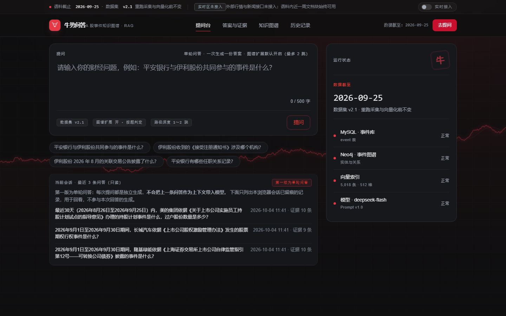
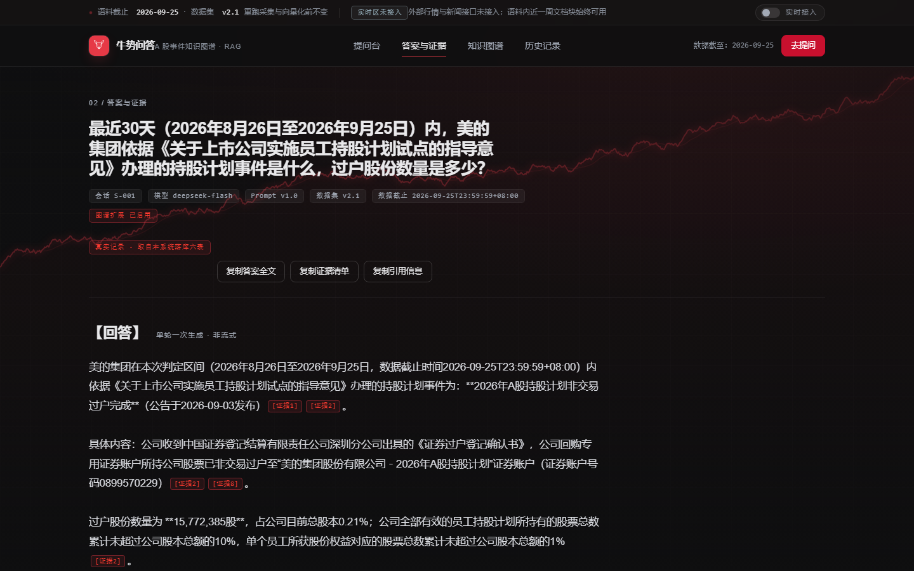
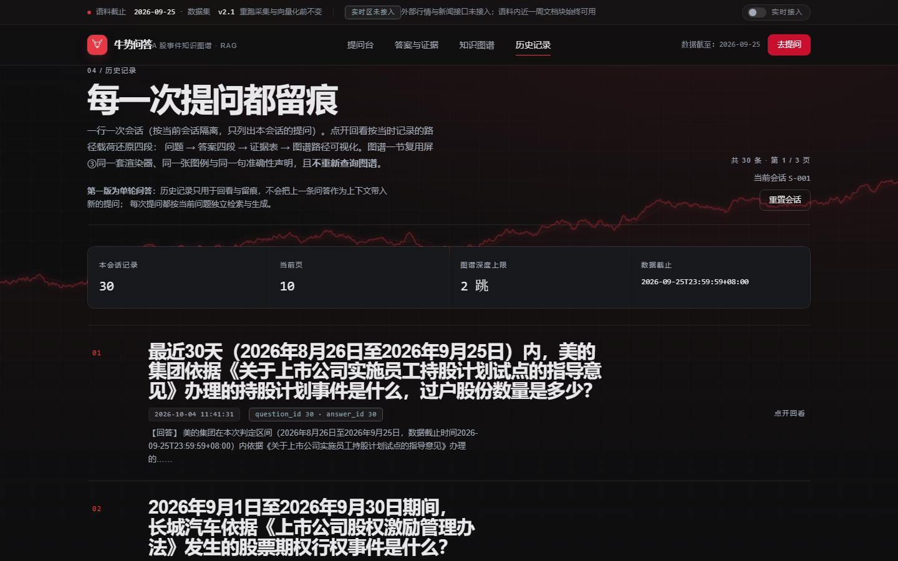
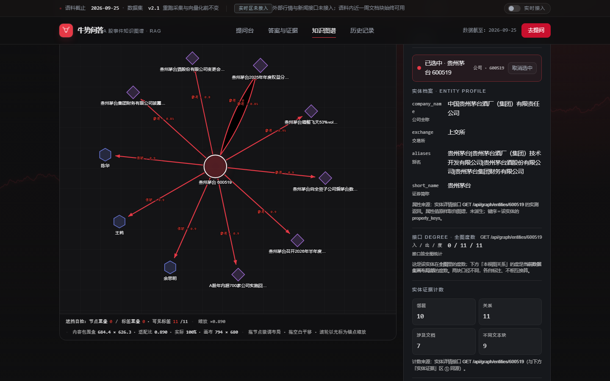

# 用户与管理员手册（第 5 轮 · 任务十三.3）

> 面向两类读者：**普通用户**（浏览器提问、看答案与证据）与**管理员**（导入文档、检查一致性、
> 查看抽取/消歧、跑受控实验）。本文只描述现有功能，不引入未实现的能力。
> 核对日期：2026-10-18。前端入口默认 `http://127.0.0.1:5173/`，后端 `http://127.0.0.1:8000/`。

---

# 第一部分 · 普通用户手册

## 一、系统能做什么

- 输入一个 A 股财经问题，得到**一段有证据支撑的回答**；
- 回答固定四段：`【回答】`、`【证据来源】`、`【知识图谱路径】`、`【数据截至与判定区间】`；
- 可逐条查看证据原文、文档标题、来源网站、发布时间、图谱路径；
- 历史记录按**浏览器会话**隔离；
- 图谱查询页可按公司/机构/人物/事件检索实体、查看一跳邻居与多跳路径。

**不能做什么（明确边界）**：

- **不提供投资建议**：不评级、不给目标价、不预测涨跌、不建议买卖；
- **不是实时行情系统**：回答基于数据集截止时间之前的公告/新闻/研报；实时区只作展示，
  **不进入问答证据链**；
- **单轮问答**：一次提问生成一份答案，不支持追问式多轮对话；
- 不回答与 A 股财经信息无关的问题；此类问题会得到「未检索到可引用证据」的提示，而不是编造答案。

---

## 二、第一次使用

1. 打开前端地址（本机 `http://127.0.0.1:5173/`）；
2. 页面首次访问会自动生成一个**会话号**保存在浏览器本地（`localStorage`），无需注册登录；
3. 在输入框输入 1～500 字的问题，点击提问；
4. 等待期间可点「取消等待」——**只停止浏览器等待**，后端可能仍会完成并写入本会话历史；
5. 回答生成后进入答案页；也可在「历史记录」中回看。

> 会话隔离：换浏览器、清空站点数据或点「重置会话」都会生成新会话号；旧会话的服务端记录
> 不会删除，只是不再显示在当前浏览器的历史页。



**关于「最近问答」**：提问页下方只读列出当前会话最近 3 条问答，用来帮助回看；
它**不会**被当作上下文送进模型——第一版是单轮问答，每次提问独立生成（界面已明确标注）。

---

## 三、如何提问

**推荐问法**：

- 「贵州茅台 2026 年上半年的营业收入和净利润是多少？」
- 「平安银行与伊利股份共同参与的事件是什么？」
- 「某公司 2025 年发布了哪些重大合同公告？」
- 「某行业在 2026 年有哪些相关政策？」

**提问建议**：

| 建议 | 说明 |
| --- | --- |
| 带上公司简称/全称或 6 位股票代码 | 便于实体解析与图谱扩展 |
| 明确时间范围 | 「2026 年上半年」「2025 年」比「最近」更稳定 |
| 一次问一件事 | 单轮生成，复合问题容易漏答 |
| 不要要求投资建议 | 此类要求会被门禁拦截或拒答 |
| 1～500 字 | 空问题、超长问题、控制字符会被 400 拒绝 |

**示例问题按钮**：提问页提供预置示例，点击即可填入；「查看一条示例答案」会打开一条固定示例，
不消耗模型调用。

---

## 四、理解答案页

| 区域 | 内容 | 怎么用 |
| --- | --- | --- |
| 回答 | 模型生成的唯一自由文本段 | 先读结论；文中 `[证据n]` 对应下方证据 |
| 证据来源 | 代码按落库证据渲染 | 逐条看标题、来源、发布时间，可点原文链接 |
| 知识图谱路径 | 代码按图谱查询结果渲染 | 看公司/事件/机构之间的路径；无扩展时显示固定字样 |
| 数据截至与判定区间 | 代码按数据集元信息与题集时间口径渲染 | 确认答案的时间边界；相对时间题会给出判定区间 |

**引用规则**：`[证据n]` 只能引用本次回答实际检索到的证据；编号越界、缺少引用、日期无出处等
都会在返回前被门禁拦截，不会把可疑答案展示给用户。

**空结果**：若页面提示「未检索到可引用证据」，表示问题与语料不匹配或没有可用证据。
这不是系统故障，建议换一种问法或确认问题与 A 股财经信息相关。



**错误提示怎么读**：页面会先给一句普通用户能看懂的说明（例如「这次生成的答案没有通过
系统的可信性校验，已被拦截」），并在前面标出错误码；原文技术信息收在「技术信息（供管理员
排查）」折叠里。错误码与后端语义一一对应，见第七节。

---

## 五、历史记录

- 按**当前浏览器会话**列出提问与回答，按时间倒序；
- 点击一条记录可回到答案页，查看当时的证据与图谱路径；
- 历史记录是只读的，不提供编辑/删除；
- 「重置会话」只切换浏览器本地会话号，不清空服务端记录；
- **第一版为单轮问答**：历史记录只用于回看，不会把上一条问答作为上下文带入新的提问。



---

## 六、图谱查询页

支持：

- **实体检索**：按关键词搜公司/机构/人物/行业/政策等；
- **一跳邻居**：查看某实体的直接关系与证据；
- **多跳路径**：给定起点、终点（可选关系类型、跳数 1～2、时间窗），查看路径与每条边的证据；
- **事件列表**：按事件类型、股票代码、时间范围筛选，分页浏览。

**空结果**：查不到时页面显示空列表，这是正常结果，不是错误。



---

## 七、常见提示与处理

| 提示/错误码 | 含义 | 用户该做什么 |
| --- | --- | --- |
| 1001 输入为空或超长 | 问题为空/超 500 字/含控制字符 | 修改问题后重试 |
| 1002／1003 参数错误或必填缺失 | 分页、时间、枚举值不合法；缺字段 | 检查筛选条件与必填项 |
| 429／1004 | 请求过于频繁（60 次/60 秒） | 等待约 1 分钟再试 |
| 2001 资源不存在 | 记录/节点/文档不存在 | 返回列表重新选择 |
| 3001 图谱服务不可用 | Neo4j 暂不可达 | 稍后重试；管理员检查 Neo4j |
| 3002 模型超时 | 大模型响应超时 | 稍后重试或缩短问题 |
| 3003 检索服务不可用 | 向量索引/记录异常 | 稍后重试；管理员检查索引 |
| 3004 回答未通过校验 | 本次生成不可信，已拦截 | 换一种问法；不是用户输入错误 |
| 9999 服务内部错误 | 未归类异常 | 稍后重试；把请求 ID 提供给管理员 |

> 实际提示文案以页面显示为准；上表用于理解语义。

---

# 第二部分 · 管理员手册

## 一、前置条件

| 项 | 要求 |
| --- | --- |
| 后端 | `python 交付物\03-代码\后端\run.py` 已启动，`/api/health` 返回 ok |
| 管理令牌 | `交付物\03-代码\后端\config.local.json` 的 `admin_token` |
| 请求头 | 所有 `/api/admin/*` 请求必须带 `X-Admin-Token: <admin_token>` |
| 未配置令牌 | **fail closed**：所有后台接口返回 4001（HTTP 401） |
| 网络 | 管理接口不走前端 UI，直接用 curl/Postman/脚本调用 |

**安全纪律**：

- 令牌**只放在请求头**，不要写进脚本仓库、文档、截图或前端代码；
- 轮换令牌时同步更新 `config.local.json` 并重启后端；
- 令牌比较使用 `hmac.compare_digest`，但仍应通过 HTTPS/内网访问。

健康检查：

```bat
curl -s http://127.0.0.1:8000/api/health
```

---

## 二、文档管理

### 2.1 导入文档

`POST /api/admin/documents`

```json
{
  "title": "某某公司2026年半年度报告",
  "content": "这里是已抽取好的纯文本正文……",
  "source": "cninfo",
  "publish_time": "2026-08-30T18:00:00",
  "url": "https://example.invalid/report",
  "category": "定期报告",
  "company_list": ["某某公司", "600000"]
}
```

要点：

- **只收纯文本**，不是文件上传；需要先自行把 PDF/HTML 转成文本；
- 必填 `title`、`content`、`source`、`publish_time`；可选 `url`、`category`、`company_list`；
- 未登记字段 → 1002；缺必填 → 1003；
- 导入只写 `document` 与 `document_chunk`，**不重建向量索引**（`vectorized=false`）；
- 返回 `doc_id`、`chunk_count`、`ingest_time`、`reprocess_task_id`、`status` 等。

### 2.2 查询文档

`GET /api/admin/documents?source=&category=&start_time=&end_time=&page=&page_size=`

- 时间窗按 `publish_time` 闭区间；
- 返回 `doc_id`、`title`、`source`、`publish_time`、`ingest_time`、`category`、`chunk_count`。

### 2.3 修改文档

`PUT /api/admin/documents/{doc_id}`

- 文档不存在 → 2001；
- 若已被历史回答引用 → **409／2003**，响应额外带 `retained_for_history=true`；
  此时不原地修改，应以新 `doc_id` 导入新版本。

### 2.4 删除文档

`DELETE /api/admin/documents/{doc_id}`

- 未被历史回答引用 → 物理删除（含文本块）；
- 已被引用 → **409／2003**，不物理删除；该文档进入「不可再用于新检索」状态。

### 2.5 触发重处理（第一版：只登记）

`POST /api/admin/reprocess`

```json
{"scope": "document", "doc_ids": [12, 13]}
```

- 只写任务台账，**不实际重跑**（响应 `executed=false`）；
- `scope` 取文档规定的枚举；`scope=document/chunk` 时必须给 `doc_ids`。

---

## 三、抽取与消歧

### 3.1 触发抽取（第一版：只登记）

`POST /api/admin/extraction/run`

```json
{"scope": "full", "doc_ids": [], "prompt_version": "v1.0"}
```

- 只登记任务台账，统计字段均为 0，`executed=false`；
- 真正重跑请使用 `交付物/03-代码/抽取与图谱/` 下的离线脚本（见仓库 README）。

### 3.2 查询任务

`GET /api/admin/extraction/tasks/{task_id}`

- 台账中不存在 → 2001。

### 3.3 查询抽取事件

`GET /api/admin/extraction/events?event_type=&start_time=&end_time=&page=&page_size=`

### 3.4 待消歧清单

`GET /api/admin/extraction/disambiguation?page=&page_size=`

- 列出未消歧的公司提及及候选；
- 确认某条：`POST /api/admin/extraction/disambiguation/{item_id}`，请求体给出确认结果；
- 确认动作会写留痕，便于审计。

---

## 四、一致性检查

`GET /api/admin/consistency-check`

返回：

- `chunk_count`：MySQL `document_chunk` 实查；
- `vector_count`：`build_meta.json` 自报＋`vector_map.jsonl` 实点行数；
- `graph_node_counts`：图谱后端实查；
- `diff`：逐项差值；`is_consistent`：全部差值为 0 才为 true。

用途：导入/重处理/重建索引后核对三方计数；出现非零差值时先查上游产物，不要直接改库。

---

## 五、受控实验

`POST /api/admin/experiment/ask`

```json
{
  "question": "平安银行与伊利股份共同参与的事件是什么？",
  "session_id": "00000000-0000-0000-0000-000000000000",
  "experiment_group": "C",
  "run_id": "manual-20261018-01"
}
```

- `experiment_group` 取 A/B/C/D/E；
- 响应与 `/api/qa/ask` 同形，另加 `experiment_group`、`run_id`、`experiment_config`、
  `elapsed_seconds`；
- 单次可能 10～30 s；注意限流 60 次/60 秒；
- 该入口只用于评测/复核，不要用于日常用户流量。

---

## 六、启动、巡检与备份

### 6.1 启动

```powershell
powershell -ExecutionPolicy Bypass -File 交付物\10-部署\启动.ps1
# 只起后端
powershell -ExecutionPolicy Bypass -File 交付物\10-部署\启动.ps1 -NoFrontend
# 停止前后端
powershell -ExecutionPolicy Bypass -File 交付物\10-部署\启动.ps1 -Stop
```

### 6.2 日常巡检

| 检查项 | 命令/位置 | 正常值 |
| --- | --- | --- |
| 后端健康 | `GET /api/health` | mysql/neo4j/vector_index/model_config 均 ok |
| 三方一致性 | `GET /api/admin/consistency-check` | `is_consistent=true` |
| 限流 | 默认 60 次/60 秒 | 压测时临时放宽，结束恢复 |
| 日志 | 后端控制台/日志文件 | 无 9999 连续出现 |
| 指标 | `/api/health` 内嵌指标或后端日志 | 关注问答耗时、错误码分布 |

### 6.3 备份

- MySQL：使用 `mysqldump` 备份 `ashare_qa`（参考 `交付物/10-部署/备份/`）；
- 图谱：Neo4j dump 或导出 `nodes.csv`/`edges.csv`；
- 向量索引：备份 `vector_map.jsonl`、FAISS 索引、`build_meta.json`；
- 备份后核对：question/answer/answer_evidence 基线（30/30/293）与节点/关系数。

### 6.4 回滚

1. 停后端；
2. 恢复 MySQL dump 与图谱导出物；
3. 恢复向量索引文件；
4. 启动后端并跑 `/api/health` 与一致性检查；
5. 跑 `python 工具\跨文档核验.py --strict-citations` 与后端测试。

---

## 七、管理员常见问题

| 现象 | 可能原因 | 处理 |
| --- | --- | --- |
| 所有管理接口 401/4001 | 未带 `X-Admin-Token` 或值不符；未配置令牌 | 检查 `config.local.json` 的 `admin_token`，重启后端 |
| 删除/修改返回 409/2003 | 文档已被历史回答引用 | 以新 doc_id 导入新版本；不要强删 |
| 一致性检查 `is_consistent=false` | 导入后未重建索引；或上游产物缺失 | 按 `diff` 定位，重建索引/补齐产物 |
| 问答 3001 | Neo4j 不可达 | 检查容器与 bolt 端口 |
| 问答 3003 | 向量索引/记录缺失 | 检查索引文件与 `build_meta.json` |
| 问答 3002 | 模型超时 | 检查网络/端点；必要时重试 |
| 大量 429/1004 | 触发 60 次/60 秒限流 | 降低并发；压测时临时放宽并恢复 |
| 抽取/重处理无实际动作 | 第一版只登记任务 | 使用离线脚本重跑 |

---

## 八、不要做的事

- 不要把 `admin_token`、数据库口令、模型密钥写入文档、前端或提交信息；
- 不要直接改数据库来「修复」一致性差异，先查上游产物；
- 不要在压测后忘记恢复 `ASHARE_RATE_LIMIT_MAX` 默认值；
- 不要删除被历史回答引用的文档（接口会拒绝，绕过接口删库会破坏证据链）；
- 不要在论文/答辩材料目录中做任何修改。
